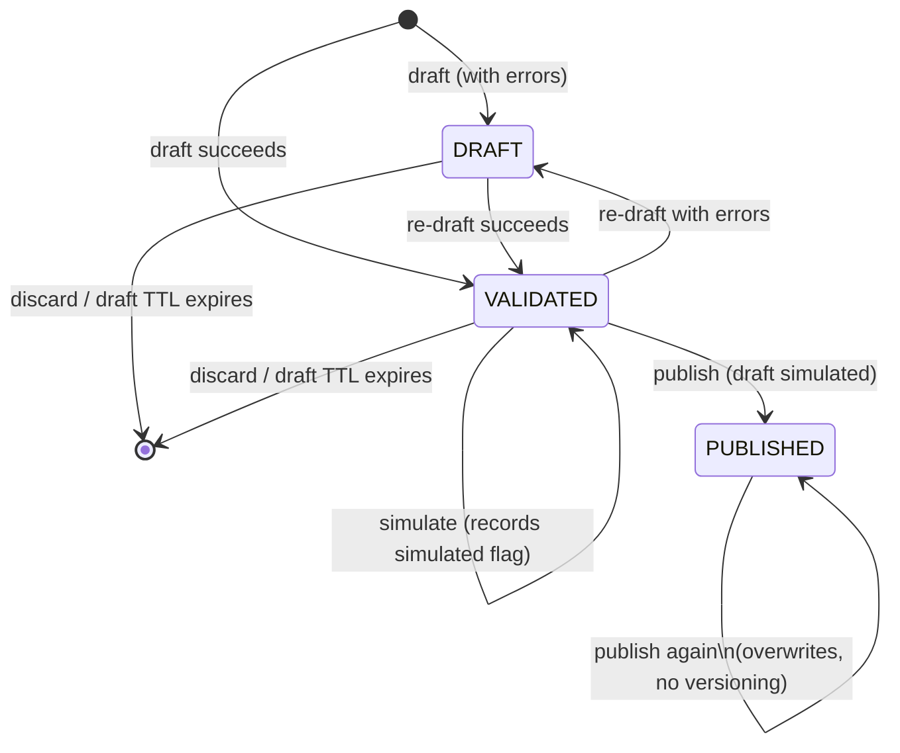
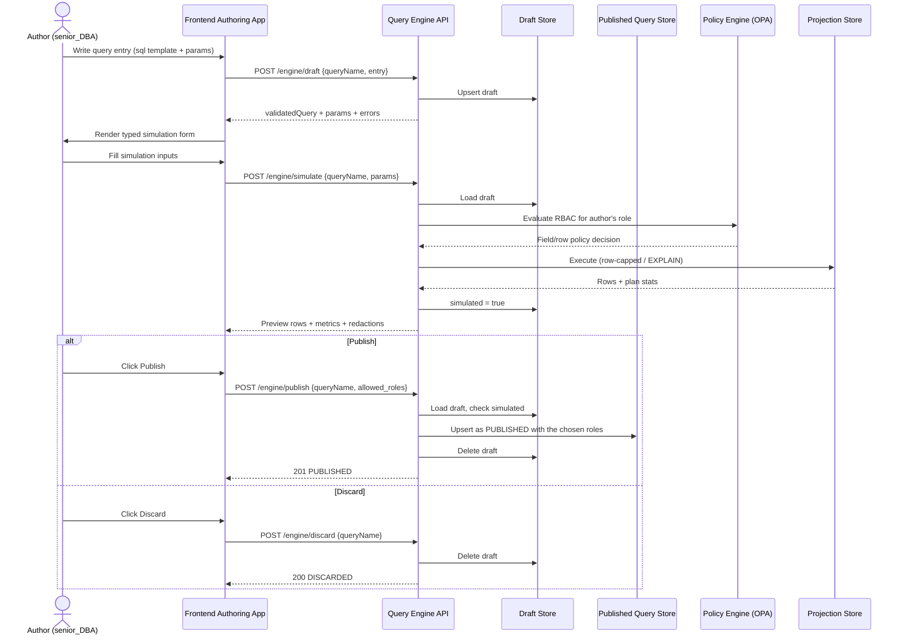
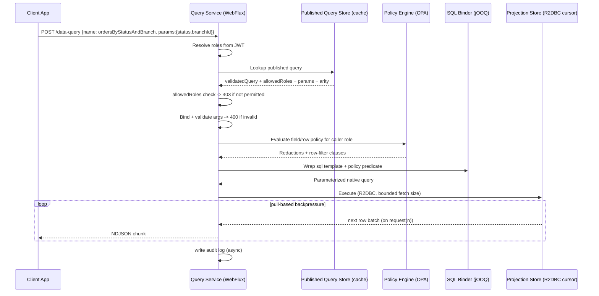
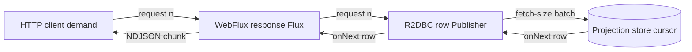

# Policy-Compiled Query DSL Service — Implementation PRD

Oct 7, 2026 · @Anirudhya Sarker

## Relationship to the Read Engine PRD

[Generic Query Service (Read Engine) — PRD](Generic%20Query%20Service%20%28Read%20Engine%29%20%E2%80%94%20PRD.md) already chose the **policy-compiled query DSL** approach and defined its core contract: a JSON query AST (`from`/`select`/`where`/`orderBy`/`page`), a compiler that turns that AST into native store queries, and an OPA/Rego policy layer that redacts fields and rows at compile time. That PRD's Phase 1 ("Foundation") is "a single projection queryable end to end, no RBAC yet."

This PRD is the concrete design for that foundation phase, specifically the workflow the team walked through: how an author **defines and simulates** a query before anyone can call it, and how a published query is **invoked** by a client app at runtime over a reactive stream. It does not revisit the approach decision — it assumes the Read Engine PRD's own JSON AST (for ad hoc `/query` calls) and OPA policy layer, and adds the pieces that document was silent on: the authoring/publishing lifecycle for named, published queries, the `allowed_roles` gate's place in the RBAC model, and the Java/reactive backend design.

## Assessment of the proposed design

| # | Concern in the original proposal | Recommendation |
| --- | --- | --- |
| 1 | The query body is shown as hand-written SQL (`SELECT ... FROM ... WHERE ...`). Raw SQL can't be safely compiled with field/row redaction, can't be cost-limited, and reopens the injection and unbounded-scan risks the prior PRD explicitly ruled out as non-goals. | The `sql` field stays a template, never a string built at runtime: arguments are written as `:argName` and bound through the driver's native named-parameter binding, which closes the injection risk without a full SQL-to-AST translation. The template is the executable query itself — RBAC composes around it (derived-table wrap for row-level, post-fetch redaction for field-level) instead of inside a parsed `where` tree. See "Query definition format" below. |
| 2 | `@Allow` reads as the only RBAC mechanism, but the prior PRD already defines field- and row-level ABAC via OPA/Rego. Two unreconciled RBAC layers invite confusion about which one governs what. | Make `allowed_roles` (the YAML field carrying the `@Allow` idea) the **coarse, operation-level gate**: can this role invoke this published query at all? It composes with, not replaces, the existing field/row policies, which still apply to every row and field the query touches regardless of who's allowed to call it. |
| 3 | No versioning or immutability. Editing a published query in place can silently break every client app that already depends on it. | Deferred for this phase: publishing a `queryName` again simply overwrites the previous published query, with no version history, deprecation window, or version pinning for callers. Flagged as an open question below rather than solved here. |
| 4 | Simulation runs real queries against real projection data with no stated limits — a bad `WHERE` clause during a demo can trigger a full scan. | Simulation reuses the same simulate-time cost limiter from the Read Engine PRD (row cap, timeout, `EXPLAIN` instead of full execution where possible) and requires the same `allowed_roles`-equivalent authoring privilege, not open access. |
| 5 | No arity enforcement for `-> Order[]` vs `-> Order`. Nothing stops a query declared as "single" from matching many rows. | Deferred for this phase: the query entry carries no declared result type or arity at all, so there's nothing to enforce. `/data-query` always returns the row list as-is. Flagged as an open question below if declared result shapes come back later. |
| 6 | No namespacing — `queryName` collisions across teams/bounded contexts are likely once this is self-service. | Published queries are namespaced by their owning module file (e.g. `orders_sql.yml` → `orders.ordersByStatusAndBranch`), matching the projection registry's existing ownership model with no separate namespace field to keep in sync. |
| 7 | Large list responses as a single buffered JSON array fight the stated goal of reactive streaming with backpressure — the server still has to hold the whole array (or at least its framing) open. | Stream list results as newline-delimited JSON (NDJSON), one row per `onNext`, so the HTTP response body never requires buffering beyond what backpressure already allows. |

## Query lifecycle



## Query definition format (YAML)

Reassessing the grammar-based DSL from the previous revision of this PRD: it bought draft-time validation of column/table references at the cost of a hand-rolled parser the query registry service would have to own and maintain. **For now, we adopt a flatter format instead.** Each bounded context's queries live in a `{module}_sql.yml` file, one YAML list of correlated query entries; a query's `sql` field is the templated SQL itself, with arguments written as `:argName` — the same named-parameter convention JDBC/R2DBC drivers already bind natively. This drops the custom grammar and the SQL→AST translation step entirely: the query registry service's "compiler" shrinks to extracting `:paramName` tokens from the template and checking them against the declared `params`.

```yaml
- name: a_query_name
  # example SQL string:
  #   SELECT projection_a, projection_b, projection_c
  #   FROM a_table
  #   WHERE colA = :arg1 AND colB = :arg2
  sql: a_sql_string
  params:
    param1: a_data_type
    param2: another_data_type
  allowed_roles: Role[]
```

A concrete module file, `orders_sql.yml`, grouping two correlated queries owned by the orders bounded context:

```yaml
# orders_sql.yml
- name: ordersByStatusAndBranch
  sql: >
    SELECT orderId, status, total, branchId
    FROM order_projection
    WHERE status = :status AND branchId = :branchId
  params:
    status: String
    branchId: int
  allowed_roles: [senior_DBA, chief_DBA]

- name: orderById
  sql: >
    SELECT orderId, status, total, branchId
    FROM order_projection
    WHERE orderId = :orderId
  params:
    orderId: String
  allowed_roles: [senior_DBA, chief_DBA, support_agent]
```

`queryName` is now `{moduleFile}.{name}` — `orders.ordersByStatusAndBranch` — which gives namespacing (Assessment, #6) for free from the file layout, with no separate namespace field to keep in sync.

### What the query registry service actually builds

There is no AST in the Read Engine PRD's sense (a `from`/`select`/`where` tree) for a published query anymore. Loading a module file produces, per entry, a lightweight `ValidatedQuery` descriptor:

```json
{
  "queryName": "orders.ordersByStatusAndBranch",
  "sql": "SELECT orderId, status, total, branchId FROM order_projection WHERE status = :status AND branchId = :branchId",
  "params": [
    { "name": "status", "type": "STRING" },
    { "name": "branchId", "type": "INT" }
  ],
  "allowedRoles": ["senior_DBA", "chief_DBA"]
}
```

Building it is two steps, neither of which parse SQL:

1. Scan `sql` for `:identifier` tokens with a regular expression.
2. Cross-check the token set against `params` — a token with no declared type, or a declared type never used in `sql`, is a load-time error for that module file.

There is no declared result type or shape in this PoC; the engine makes no checks on what a query returns, it just runs the template and hands back whatever rows come out. There is also no ownership/attribution field (`owner`) in this phase — if that's needed later it's a separate feature request, not bundled into drafting or publishing here.

| `params` value | Java/R2DBC binding |
| --- | --- |
| `String` | `java.lang.String` |
| `int` | `int` |
| `long` | `long` |
| `decimal` | `java.math.BigDecimal` |
| `boolean` | `boolean` |
| `date` | `java.time.LocalDate` |
| `datetime` | `java.time.OffsetDateTime` (parsed from an ISO-8601 instant, UTC) |

### Trade-off: what this format gives up

The grammar-based approach resolved `FROM`/column references against the projection registry at draft time — an unknown column was a load-time error. Treating `sql` as an opaque template drops that check: a typo in a column name now only surfaces when the query actually runs — still at simulate time, before publish, so nothing broken reaches a client, it just moves the failure one step later in Phase 1.

### RBAC composition over a templated SQL string

Because `sql` is text the query registry service doesn't parse, the Read Engine PRD's field- and row-level OPA policies can't be spliced into a `where` tree anymore. They compose at two different points instead:

- **Row-level**: the templated SQL is wrapped as a derived table, and the OPA-generated predicate is applied as an outer filter — `SELECT * FROM (<templated sql>) q WHERE <policy predicate>` — rather than being merged into the template's own `WHERE` clause. The policy predicate may only reference columns the template actually selects, which the published query store validates when the policy is authored.
- **Field-level**: the template always selects its full declared column set; redaction happens by omitting disallowed fields from the response payload after the row is fetched, not by rewriting the `SELECT` list text. This costs a little efficiency (the store still computes the redacted column) but avoids string surgery on a SQL template, and keeps the redaction logic identical to the Read Engine PRD's.

---

## Current implementation (as built)

What the code does today (query-engine `0.0.1-SNAPSHOT`, 2026-10-17). The design sections around this one describe the intended shape; where they disagree with this section, this section reflects the code. The gaps are listed in "Differences between the design and the code" at the end of this section.

### Where it lives

`query-engine` is a library, not an application. Each domain query service (`order-query` on 8081, `inventory-query` on 8082) embeds it through `QueryEngineAutoConfiguration`, which registers the endpoints below and creates the engine's own tables in the service's database on startup (`query-engine/schema.sql`, idempotent). The service supplies only its `spring.r2dbc.*` connection and its projection tables. Everything is reactive (WebFlux controller, then service, then R2DBC `DatabaseClient`), and no query lifecycle state is held in memory.

| Piece | Class (package `com.brac.query.engine`) | Job |
| --- | --- | --- |
| Endpoints | `web.EngineController`, `web.DataQueryController`, `web.QueryRolesController` | `/engine/*`, `/data-query`, `/query-roles` |
| Error mapping | `web.GlobalExceptionHandler`, `error.EngineException` | One JSON error shape `{ error, message, queryName }` |
| Lifecycle | `service.QueryEngineService` | Draft, simulate, publish, discard, list, invoke |
| Validator | `validation.QueryValidator` | Checks `:param` tokens against declared params; builds `ValidatedQuery` |
| Draft store | `store.DraftStore` | Table `query_draft` |
| Registry | `store.PublishedQueryRepository` | Table `published_query` |
| Identity catalog | `store.QueryRolesRepository` | Tables `realm_role`, `realm_group` |
| Executor | `execution.ProjectionStoreExecutor` | Runs the SQL template against the domain's projection tables |
| JSONB codec | `store.JsonbSupport` | Reads and writes JSONB columns as r2dbc-postgresql `Json` |

### How a query is handled

**Draft** (`POST /engine/draft`, or `/engine/draft-yml` for YAML bodies; both run the same logic)
1. `queryName` must match `^[a-zA-Z0-9_]+\.[a-zA-Z0-9_]+$` (`{module}.{name}`), otherwise `400 INVALID_QUERY_NAME`.
2. Lock check: an unexpired draft held by a different `X-Author` gives `409 DRAFT_LOCKED`.
3. Validation, without parsing SQL: the regex `:([a-zA-Z_][a-zA-Z0-9_]*)` finds the parameter tokens in `sql`, and they are compared with the declared `params`. Problems become `UNDECLARED_PARAM`, `UNUSED_PARAM`, `UNKNOWN_PARAM_TYPE` or `MISSING_SQL` entries in `errors`.
4. With errors, the draft is stored with `status = DRAFT` and `validated_query = NULL`. Without errors it is `VALIDATED` and carries a `ValidatedQuery { sql, params: [{ name, type }], allowedRoles }`.
5. The draft is always stored (upsert by `query_name`), even with errors, with `simulated = false` and `expires_at = now + 7 days`. The response returns the status, errors, validated descriptor, the submitted `entry { sql, params }` and `simulated`.

**Simulate** (`POST /engine/simulate`)
1. Loads the draft (`404 DRAFT_NOT_FOUND` if missing or expired). A `DRAFT`-status draft gives `422 DRAFT_INVALID`.
2. Checks the supplied params against the validated list: every declared param must be present and type-compatible, otherwise `400 INVALID_ARGUMENT`.
3. Executes the SQL template against the projection tables (see "Executor" below). Simulate is capped at 200 rows (`query-engine.simulate.max-rows`).
4. Saves the draft with `simulated = true` and a fresh 7-day expiry.
5. Returns the rows, `rowCount`, `truncated` and `metrics { latencyMs, rowsScanned, planCost }`. Only `latencyMs` is measured. `rowsScanned` is the number of rows returned, and `planCost` is a random placeholder, not a PostgreSQL planner figure. `redactedFields` is always empty.

**Publish** (`POST /engine/publish`, body `{ queryName, allowed_roles }`)
1. Loads the draft. Not simulated gives `422 NOT_SIMULATED`.
2. `allowed_roles` are taken from the publish request (trimmed, blanks dropped, de-duplicated); none left gives `422 NO_ALLOWED_ROLES`. They replace whatever the draft carried. An `allowed_roles` field on the draft body is still accepted and stored on the draft, but publish ignores it.
3. Upserts `published_query` with the chosen roles and deletes the draft. The method is `@Transactional`, so the two steps are meant to be atomic (not yet verified under failure).
4. Returns `201 { queryName, status: "PUBLISHED", publishedAt, publishedBy }`, where `publishedBy` is the `X-Author` header.

**Discard** (`POST /engine/discard`) loads the draft (`404` if missing) and deletes it. A published version of the same name is untouched.

**List** (`POST /engine/list`) reads every `published_query` row and every unexpired `query_draft` row, merges them by `queryName` in name order, and returns `{ published, draft }` per name (either can be `null`). Filters: `module`, `queryNamePrefix`, `status`, and `author` (matches drafts only). `page.size` defaults to 50 (max 200). `page.cursor` is ignored.

**Invoke** (`POST /data-query`, body `{ name, params }`, caller roles in the `X-Roles` header)
1. A name containing `.` is used as is. A bare name must match exactly one published name by suffix, otherwise `404 QUERY_NOT_FOUND`.
2. Loads the published query (`404 QUERY_NOT_FOUND` if missing).
3. Role gate: the comma-separated `X-Roles` values (default `senior_DBA` when the header is absent) must include at least one of the query's `allowedRoles`, by exact string match. Realm roles and groups share one name space. Otherwise `403 FORBIDDEN`.
4. Param check as in simulate (`400 INVALID_ARGUMENT`).
5. Executes the SQL and returns a JSON array of rows, capped at 200, with no signal when rows were dropped. The response is fully buffered; see `docs/reactive_R2DBC_Cursor-impl.md` for the streaming plan.

**Identity catalog** (`GET /query-roles`) returns `{ realmRoles: [{ name, description }], groups: [{ name, path, description }] }` from the two catalog tables. The UI uses it to choose `allowed_roles` at publish time and a calling identity at run time.

### Parameter types

Types are declared as text in `params` (case-insensitive) and resolved to `ParamType`.

| Declared | Enum | JSON value accepted | Bound to the driver as |
| --- | --- | --- | --- |
| `String` | `STRING` | string | `String` |
| `int` | `INT` | integer that fits `Integer` | `Integer` |
| `long` | `LONG` | integer | `Long` |
| `decimal` | `DECIMAL` | any number | `BigDecimal` |
| `boolean` | `BOOLEAN` | `true` / `false` | `Boolean` |
| `date` | `DATE` | string `YYYY-MM-DD` | `LocalDate` |
| `datetime` | `DATETIME` | string, ISO-8601 instant | `OffsetDateTime` (UTC) |

### Executor

`ProjectionStoreExecutor` hands the stored SQL template to `DatabaseClient.sql(...)`. The `:name` markers are bound by name through the driver's native parameter binding (translated to `$N`), so argument values are never concatenated into the SQL. A missing value is bound as a typed null. Rows come back as `LinkedHashMap<column, value>`, with Postgres lower-casing unquoted column names (`orderId` comes back as `orderid`). Simulate and invoke both use this one method, which today reads the full result set into a list before applying the 200-row cap.

### Database tables

Each domain service has its own database. It contains the engine's four tables (created by `schema.sql`) plus that domain's projection tables.

**`query_draft`** (the draft store; one open draft per query)

| Column | Type | Notes |
| --- | --- | --- |
| `query_name` | `VARCHAR(255)` PK | `{module}.{name}` |
| `sql_text` | `TEXT` | SQL template exactly as submitted |
| `params` | `JSONB` | Declared types as the author wrote them, e.g. `{"status":"String","branchId":"int"}` |
| `allowed_roles` | `JSONB` | Legacy: whatever the draft body carried, normally JSON `null`. Not used by publish |
| `validated_query` | `JSONB`, nullable | `{ "sql": "...", "params": [{ "name": "status", "type": "STRING" }], "allowedRoles": [] }`; SQL `NULL` when `status = DRAFT` |
| `status` | `VARCHAR(32)` | `DRAFT` (has errors) or `VALIDATED` |
| `errors` | `JSONB` | `[{ "code": "UNDECLARED_PARAM", "param": "branchId", "message": "…" }]`, empty array when valid |
| `simulated` | `BOOLEAN` | `false` after every draft save, `true` after a successful simulate |
| `author` | `VARCHAR(255)` | `X-Author` of the last saver; the lock holder |
| `updated_at`, `expires_at` | `TIMESTAMPTZ` | `expires_at = updated_at + 7 days`, refreshed by draft and simulate |

**`published_query`** (the registry; one live version per query, no history)

| Column | Type | Notes |
| --- | --- | --- |
| `query_name` | `VARCHAR(255)` PK | Same name space as drafts |
| `sql_text` | `TEXT` | Copied from the draft |
| `params` | `JSONB` | Declared types, copied from the draft |
| `allowed_roles` | `JSONB` | Roles/groups chosen at publish, e.g. `["data_analyst","finance"]` |
| `validated_query` | `JSONB` NOT NULL | Same shape as in `query_draft`; `allowedRoles` holds the roles chosen at publish. The role gate and the list read this copy |
| `published_at`, `published_by` | `TIMESTAMPTZ`, `VARCHAR(255)` | When and by whom (`X-Author`) |

**`realm_role`** (`name` PK, `description`) and **`realm_group`** (`name` PK, `path`, `description`) are the identity catalog behind `/query-roles`. They are seeded by `schema.sql` (8 roles, 7 groups). In a real deployment they would mirror the enterprise identity provider.

Who touches the tables:

| Operation | Reads | Writes |
| --- | --- | --- |
| draft / draft-yml | `query_draft` (lock check) | `query_draft` (upsert) |
| drafted | `query_draft` | none |
| simulate | `query_draft`, projection tables | `query_draft` (`simulated`, `updated_at`, `expires_at`) |
| publish | `query_draft` | `published_query` (upsert), `query_draft` (delete) |
| discard | `query_draft` | `query_draft` (delete) |
| list | `query_draft` (unexpired), `published_query` | none |
| `/data-query` | `published_query`, projection tables | none |
| `/query-roles` | `realm_role`, `realm_group` | none |

**Projection tables** are the domain's read models, owned by each domain service and seeded by its `docker/init` scripts. They are flat, denormalized and keyed by a business id, with filterable columns the published SQL selects on:

| Service | Table | Shape |
| --- | --- | --- |
| `order-query` | `order_projection` (24 rows) | `orderId` PK, `status`, `total`, `branchId`, `channel`, `customerTier`, `orderDate` |
| `inventory-query` | `inventory_projection` (24 rows) | `(sku, warehouse_id)` PK, `product_name`, `category`, `supplier_id`, `quantity_on_hand`, `reorder_level`, `unit_price`, `status`, `last_restocked` |

A 50,000-row `order_history_projection` for the streaming demo exists in `order-query` (see `docs/reactive_R2DBC_Cursor-impl.md`).

### Known limitations as built

- The `:name` scan reads every `:identifier` in the SQL as a parameter. A Postgres cast such as `x::text`, or a colon inside a string literal, produces a false `UNDECLARED_PARAM`. Use `CAST(x AS text)` instead.
- Nothing restricts what the SQL does. Published SQL runs with the service's full database rights, including writes.
- Malformed `date` / `datetime` / number strings are rejected at call time as `400 INVALID_ARGUMENT`.
- Simulate metrics are placeholders (see Simulate above).
- Expired drafts are hidden at read time. The `sweepExpired` method exists but nothing calls it, so expired rows stay in the table.
- Caller identity is a stand-in: `X-Author` on `/engine/*` (default `anonymous`) and `X-Roles` on `/data-query` (default `senior_DBA`). There is no authentication.
- Publishing is not author-checked: any caller can simulate, publish or discard any draft. Only a second `draft` call is blocked by the lock.

### Differences between the design and the code

| Design text elsewhere in this document | What the code does |
| --- | --- |
| Queries live in `{module}_sql.yml` files with `allowed_roles` in the YAML | Queries are authored one at a time through the API or UI as `queryName`, `sql`, `params`. `allowed_roles` are chosen at publish |
| `allowed_roles` declared at draft time; publish takes `{ queryName }` | Publish requires `allowed_roles` (`422 NO_ALLOWED_ROLES` otherwise) |
| `enum(A, B, ...)` param type | Not implemented; seven types only (table above) |
| Only the draft's author can simulate, publish or discard; `chief_DBA` can force-discard | Not enforced (see limitations) |
| Scheduled sweeper with a `DRAFT_EXPIRED` audit entry | Not implemented |
| Simulation under a cost limiter with timeout and `EXPLAIN`, plus OPA redaction | Row cap of 200 only; no timeout, `EXPLAIN` or OPA |
| `list` supports `filter.author = "me"` and `page.cursor` | `"me"` is not special; cursor ignored |
| Phase 2: JWT, published-query cache and change events, OPA, jOOQ binder, arity, NDJSON streaming, `X-Next-Cursor` / `X-Redacted-Fields` | JWT, cache, OPA, jOOQ binder, arity, `X-Next-Cursor` / `X-Redacted-Fields` are not built. Roles come from `X-Roles`; each call reads the registry. NDJSON streaming with backpressure is built (`Accept: application/x-ndjson`; JSON is capped at 1000 rows with `413`); see `docs/reactive_R2DBC_Cursor-impl.md` |
| Authoring role precondition for Phase 1 | Not enforced |

---

## Phase 1 — Query Definition & Simulation (design-time)

**Actors**: Author (e.g. `senior_DBA`, `chief_DBA`), Frontend authoring app, Query Engine API, Draft Store, Published Query Store, Policy Engine (OPA), Projection Store.

**Precondition**: the author holds an authoring role for the target projection, separate from (and typically a superset of) any role listed in the query's own `allowed_roles`.

### Endpoint shape

Every design-time endpoint is a fixed `POST` under one `/engine` resource; the URL names only the action. Each endpoint that works on a single query takes the namespaced `queryName` (`{module}.{name}`) in the request body. `list` is the one exception: it works on many queries, so it takes filters instead of a `queryName`.

There is no versioning: drafting a `queryName` again overwrites whatever draft was open for it, and publishing a `queryName` again overwrites whatever was previously published under that name. There's no revision counter and nothing analogous to a "409 conflicting edit" response — the simplifying assumption for this phase is that an author's own draft and a published query are each a single current value per `queryName`, not a history.

Content type is JSON by default across every endpoint. The one exception is drafting: `POST /engine/draft` and `POST /engine/draft-yml` are two separate endpoints for the exact same operation — the former takes `application/json`, the latter takes `application/yaml` — and both return `application/json`. There's no content negotiation on one path; the YAML variant is simply a second route a YAML-producing caller (e.g. a `.http` client, or a tool that edits `{module}_sql.yml` entries directly) can use instead.

| Action | Endpoint | Consumes | Produces | Body | Effect on the draft |
| --- | --- | --- | --- | --- | --- |
| Draft | `POST /engine/draft` | `application/json` | `application/json` | `{ queryName, sql, params }` | Creates or overwrites the draft for `queryName` |
| Draft (YAML) | `POST /engine/draft-yml` | `application/yaml` | `application/json` | same fields as above, YAML-encoded | Same effect as `POST /engine/draft` |
| Resume | `POST /engine/drafted` | `application/json` | `application/json` | `{ queryName }` | Read-only; returns the stored draft if one is open |
| Simulate | `POST /engine/simulate` | `application/json` | `application/json` | `{ queryName, params }` | Executes the stored draft; marks it as simulated |
| Publish | `POST /engine/publish` | `application/json` | `application/json` | `{ queryName, allowed_roles }` | Promotes the stored draft to published with the chosen `allowed_roles`; deletes the draft |
| Discard | `POST /engine/discard` | `application/json` | `application/json` | `{ queryName }` | Deletes the draft; nothing is published |
| List | `POST /engine/list` | `application/json` | `application/json` | `{ filter, page }` (all optional) | Read-only; returns drafted and published queries, one entry per `queryName` |

`queryName` is always the first field of the body and is the lookup key into the Draft Store; the body never repeats the SQL or the validated descriptor after drafting. Resume is a `POST` rather than a `GET` so the query name stays in the body, not the URL.

### How drafting stores the draft

`draft` (JSON) and `draft-yml` (YAML) are the only calls that accept query content; both run the exact same validate/store logic underneath, just parsing a different body format first. On success *or* failure the engine writes a server-side **draft record** to the Draft Store, keyed by `queryName`:

| Draft field | Notes |
| --- | --- |
| `queryName` | Primary key — `{module}.{name}`, taken from the `queryName` field of the draft body. At most one open draft per `queryName`. |
| `entry` | The submitted YAML-equivalent entry, verbatim. |
| `validatedQuery` | The `ValidatedQuery` descriptor, or `null` if validation failed. |
| `status` | `DRAFT` (validation errors) or `VALIDATED` (no errors). |
| `errors` | Load-time errors from the last draft call. |
| `simulated` | `true` once a simulate against this draft has succeeded; reset to `false` on every re-draft. |
| `author` | The `X-Author` of the last saver. Another author's `draft` call is blocked while the draft is open; simulate, publish and discard are not author-checked yet. |
| `updatedAt` / `expiresAt` | `expiresAt = updatedAt + draft TTL` (default 7 days, sliding on every draft/simulate call). |

Rules that follow from this record:

- `simulate`, `publish`, and `discard` always operate on the stored draft for the `queryName` in the body, never on a payload the client sends back.
- `simulate` is rejected with `422 DRAFT_INVALID` if the draft is `DRAFT` (has validation errors), and with `400 INVALID_ARGUMENT` if a required param is missing or has the wrong type — see "Param validation" below.
- `publish` is rejected with `422 NOT_SIMULATED` unless the draft has been simulated. Re-drafting resets `simulated` to `false`, so re-drafting after a simulation forces a fresh simulation before publish.
- A `draft` call from a different author while a draft is open returns `409 DRAFT_LOCKED` (with the holder and `expiresAt`), so two authors can't silently overwrite each other.
- Drafting a `queryName` that is already published opens a draft that will replace it on publish; the published query keeps serving traffic untouched until then.

### Param validation

Two different checks catch bad params, at two different points in the lifecycle:

- **At draft time** (`validatedQuery` building): the engine scans `sql` for `:identifier` tokens and cross-checks them against the declared `params` map. A token used in `sql` but missing from `params` is `UNDECLARED_PARAM`; a name declared in `params` but never used in `sql` is `UNUSED_PARAM`; an unrecognized type value is `UNKNOWN_PARAM_TYPE`. All of these keep the draft at `status: DRAFT` instead of `VALIDATED`, and `simulate` on it fails with `422 DRAFT_INVALID`.
- **At simulate/invoke time** (bound values): once a draft is `VALIDATED` (or a query is published), the actual argument map passed to `simulate` or `/data-query` is checked against the validated param list — a missing key or a value whose Java type doesn't match the declared one (e.g. a string where `int` was declared) returns `400 INVALID_ARGUMENT`, naming the offending param.

### Steps

1. Author writes the query entry — `queryName`, templated `sql`, `params` — through the frontend editor (YAML) or the API. `allowed_roles` are not part of the entry; they are chosen at publish.
2. Frontend sends the entry, with `queryName: "orders.ordersByStatusAndBranch"`, to `POST /engine/draft`. The engine extracts `:paramName` tokens from `sql` and checks them against `params` — no SQL parsing or column/result-type resolution happens here.
3. The engine writes the draft record (above) and returns the `ValidatedQuery` descriptor, `status`, `expiresAt`, and any load-time errors (an undeclared or unused parameter). If there are errors the draft is stored as `DRAFT` and the flow stops here until the author re-drafts — nothing executes.
4. Frontend renders a simulation form generated from `params` in the response (`status: String`, `branchId: int`, …).
5. Author fills in sample values; frontend submits `POST /engine/simulate` with `{ queryName, params }`.
6. The engine loads the stored draft, evaluates the OPA policy for the author's own role (same enforcement point as live traffic) — wrapping `sql` with the row-level predicate described above — then executes it against the projection store under the cost limiter (row cap, timeout, or `EXPLAIN`-only).
7. The engine marks the draft `simulated: true`, extends `expiresAt`, and returns preview rows, performance metrics (latency, rows scanned, plan cost), and any fields the author's own role would have redacted — so the author sees exactly what a real caller with that role would see.
8. Author iterates (edit → re-draft → resimulate) as needed.
9. Author either:
   - clicks **Publish** and picks the realm roles and groups that may invoke the query (from `GET /query-roles`): frontend sends `POST /engine/publish` with `{ queryName, allowed_roles }`. The engine copies the stored `entry` and `validatedQuery` into the published query store with those roles and deletes the draft (there is no published-query-changed event or cache yet); or
   - clicks **Discard**: frontend sends `POST /engine/discard` with `{ queryName }`. The engine deletes the draft. Any previously published query of the same name is unaffected.



### What happens if the frontend never calls publish or discard

A draft is never callable. `POST /data-query` reads only from the Published Query Store, and drafts live in the Draft Store, so a forgotten draft has no runtime effect:

- **Brand-new query**: `queryName` doesn't exist for callers; `/data-query` returns `404 QUERY_NOT_FOUND`.
- **Edit to a published query**: callers keep getting the published query untouched. The edit simply never ships.

What the open draft *does* hold is the per-`queryName` lock and storage:

- **Same author comes back** (new tab, browser crash, next day): `POST /engine/drafted` with `{ queryName }` returns the stored entry and the author continues with simulate, publish, or discard. Calling `draft` again also works — it overwrites the draft in place.
- **Different author** tries to draft the same `queryName`: gets `409 DRAFT_LOCKED` with the holder and `expiresAt`. A user with the `chief_DBA` role can force-discard the draft.
- **Nobody comes back**: a scheduled sweeper deletes drafts past `expiresAt` (default 7 days idle) and writes a `DRAFT_EXPIRED` audit entry. This releases the lock. Any later `simulate`/`publish`/`discard` call gets `404 DRAFT_NOT_FOUND`, and the author must draft again — this is the drafted-vs-non-drafted distinction `/engine/drafted` exists to surface.

`discard` is therefore a courtesy that releases the lock and storage straight away. It isn't needed for correctness; TTL expiry has the same final effect.

### Example JSON

`POST /engine/draft`

```json
{
  "queryName": "orders.ordersByStatusAndBranch",
  "sql": "SELECT orderId, status, total, branchId FROM order_projection WHERE status = :status AND branchId = :branchId",
  "params": { "status": "String", "branchId": "int" }
}
```

Response (`200`):

```json
{
  "queryName": "orders.ordersByStatusAndBranch",
  "status": "VALIDATED",
  "validatedQuery": {
    "sql": "SELECT orderId, status, total, branchId FROM order_projection WHERE status = :status AND branchId = :branchId",
    "params": [
      { "name": "status", "type": "STRING" },
      { "name": "branchId", "type": "INT" }
    ],
    "allowedRoles": []
  },
  "errors": [],
  "expiresAt": "2026-10-14T10:02:00Z",
  "entry": {
    "sql": "SELECT orderId, status, total, branchId FROM order_projection WHERE status = :status AND branchId = :branchId",
    "params": { "status": "String", "branchId": "int" }
  },
  "simulated": false
}
```

`entry` echoes what was submitted and is present even when validation failed (`validatedQuery` is then `null`), so an editor can resume the draft. `validatedQuery.allowedRoles` is empty until publish.

Response with a param validation error (`200`, draft stored as `DRAFT`):

```json
{
  "queryName": "orders.ordersByStatusAndBranch",
  "status": "DRAFT",
  "validatedQuery": null,
  "errors": [
    { "code": "UNDECLARED_PARAM", "param": "branchId", "message": ":branchId is used in sql but missing from params" }
  ],
  "expiresAt": "2026-10-14T09:58:00Z",
  "entry": {
    "sql": "SELECT orderId, status, total, branchId FROM order_projection WHERE status = :status AND branchId = :branchId",
    "params": { "status": "String" }
  },
  "simulated": false
}
```

`POST /engine/draft-yml` — same fields, YAML-encoded, response unchanged (still `application/json`, identical shape to the `/engine/draft` response above):

```yaml
queryName: orders.ordersByStatusAndBranch
sql: "SELECT orderId, status, total, branchId FROM order_projection WHERE status = :status AND branchId = :branchId"
params:
  status: String
  branchId: int
```

`POST /engine/simulate`

```json
{
  "queryName": "orders.ordersByStatusAndBranch",
  "params": { "status": "SHIPPED", "branchId": 12 }
}
```

Response (`200`):

```json
{
  "queryName": "orders.ordersByStatusAndBranch",
  "rows": [
    { "orderId": "O-1042", "status": "SHIPPED", "total": 128.50, "branchId": 12 }
  ],
  "rowCount": 1,
  "truncated": false,
  "metrics": { "latencyMs": 18, "rowsScanned": 340, "planCost": 12.4 },
  "redactedFields": [],
  "expiresAt": "2026-10-14T10:05:00Z"
}
```

Response to a simulate call with a missing or wrongly-typed param (`400 INVALID_ARGUMENT`):

```json
{
  "error": "INVALID_ARGUMENT",
  "message": "branchId expected INT, received String",
  "queryName": "orders.ordersByStatusAndBranch"
}
```

`POST /engine/publish` (the `allowed_roles` are realm roles and/or groups from `GET /query-roles`; at least one is required)

```json
{
  "queryName": "orders.ordersByStatusAndBranch",
  "allowed_roles": ["senior_DBA", "data-platform"]
}
```

Response (`201`):

```json
{
  "queryName": "orders.ordersByStatusAndBranch",
  "status": "PUBLISHED",
  "publishedAt": "2026-10-07T10:15:00Z",
  "publishedBy": "anirudhya.sarker@bracits.com"
}
```

`POST /engine/discard`

```json
{
  "queryName": "orders.ordersByStatusAndBranch"
}
```

Response (`200`):

```json
{
  "queryName": "orders.ordersByStatusAndBranch",
  "status": "DISCARDED"
}
```

### Listing drafted and published queries

`POST /engine/list` reads from both the Draft Store and the Published Query Store and merges them by `queryName`. A single query can be published and have an open draft for an edit-in-progress at the same time, so each entry has a `published` part and a `draft` part, and either can be `null`:

- Brand-new query, not published yet: `published: null`, `draft` set.
- Published query, nobody editing: `published` set, `draft: null`.
- Published query with an edit in progress: both set.

This `published`/`draft` pair is the general form of the drafted-vs-non-drafted distinction `/engine/drafted` surfaces for a single `queryName` — `list` shows it across every query at once. The list shows summaries only and leaves out SQL and the validated descriptor. To open a draft, call `POST /engine/drafted`. Callers see drafts from every author, so a `DRAFT_LOCKED` response can be traced to whoever holds the draft. Expired drafts drop out of the list once the sweeper removes them.

All body fields are optional. With an empty body `{}`, the engine returns every query that has an open draft or is published, sorted by `queryName`, 50 per page.

| Body field | Type | Notes |
| --- | --- | --- |
| `filter.module` | string | e.g. `orders`; matches the `{module}` part of `queryName` |
| `filter.queryNamePrefix` | string | e.g. `orders.orders`; simple prefix match |
| `filter.status` | string[] | Any of `DRAFT`, `VALIDATED` (draft states) or `PUBLISHED`. An entry matches if its draft or published status is in the list. |
| `filter.author` | string | Only drafts opened by this author; `"me"` means the caller |
| `page.size` | int | Default 50, max 200 |
| `page.cursor` | string | Opaque cursor from the previous response's `nextCursor` |

`POST /engine/list`

```json
{
  "filter": { "module": "orders", "status": ["VALIDATED", "PUBLISHED"] },
  "page": { "size": 50 }
}
```

Response (`200`):

```json
{
  "items": [
    {
      "queryName": "orders.orderById",
      "published": {
        "sql": "SELECT orderId, status, total, branchId FROM order_projection WHERE orderId = :orderId",
        "params": [{ "name": "orderId", "type": "STRING" }],
        "allowedRoles": ["senior_DBA", "chief_DBA", "support_agent"],
        "publishedAt": "2026-10-05T08:40:00Z",
        "publishedBy": "anirudhya.sarker@bracits.com"
      },
      "draft": null
    },
    {
      "queryName": "orders.ordersByStatusAndBranch",
      "published": {
        "sql": "SELECT orderId, status, total, branchId FROM order_projection WHERE status = :status AND branchId = :branchId",
        "params": [
          { "name": "status", "type": "STRING" },
          { "name": "branchId", "type": "INT" }
        ],
        "allowedRoles": ["senior_DBA", "chief_DBA"],
        "publishedAt": "2026-10-07T10:15:00Z",
        "publishedBy": "anirudhya.sarker@bracits.com"
      },
      "draft": {
        "status": "VALIDATED",
        "simulated": true,
        "author": "anirudhya.sarker@bracits.com",
        "updatedAt": "2026-10-08T09:12:00Z",
        "expiresAt": "2026-10-15T09:12:00Z"
      }
    }
  ],
  "nextCursor": null
}
```

`draft.simulated` is `true` once a simulate has succeeded against the current draft, which means the draft can be published right away.

Error responses share one shape across all `/engine` endpoints:

```json
{
  "error": "DRAFT_LOCKED",
  "message": "Draft for 'orders.ordersByStatusAndBranch' is held by anirudhya.sarker@bracits.com (expires 2026-10-15T09:12:00Z)",
  "queryName": "orders.ordersByStatusAndBranch"
}
```

| Code | HTTP | When |
| --- | --- | --- |
| `INVALID_QUERY_NAME` | 400 | `queryName` missing from the body or not in `{module}.{name}` form |
| `INVALID_ARGUMENT` | 400 | A param required by the validated query is missing from `params`, or has the wrong type |
| `DRAFT_NOT_FOUND` | 404 | No open draft for `queryName` (never drafted, published, discarded, or expired) — the non-drafted case |
| `DRAFT_LOCKED` | 409 | Another author holds the open draft for `queryName` |
| `DRAFT_INVALID` | 422 | Simulate on a draft with validation/param-declaration errors |
| `NOT_SIMULATED` | 422 | Publish before the draft has been simulated |
| `NO_ALLOWED_ROLES` | 422 | Publish with no roles or groups selected |
| `QUERY_NOT_FOUND` | 404 | `/data-query` for a name that isn't published, or a bare name that matches none or several |
| `FORBIDDEN` | 403 | `/data-query` caller's `X-Roles` share nothing with the query's `allowedRoles` |
| `INVALID_REQUEST` | 400 | Request body failed validation (e.g. blank `queryName` or `sql`, in `draft-yml`) |
| `MALFORMED_BODY` | 400 | Request body could not be parsed (e.g. invalid YAML in `draft-yml`) |


---

## Phase 2 — Query Invocation (run-time)

> **Implementation status.** Partly built. `POST /data-query` negotiates the format by the `Accept` header: `application/x-ndjson` streams one row per line with demand-driven reads from Postgres (backpressure), and `application/json` stays the default but returns `413 RESULT_TOO_LARGE` above 1000 rows instead of truncating silently. Caller roles come from the `X-Roles` header instead of a JWT. There is no published-query cache, OPA policy layer, jOOQ binder, arity handling or `X-Next-Cursor` / `X-Redacted-Fields` headers. Design, acceptance criteria and measured behavior are in `docs/reactive_R2DBC_Cursor-impl.md`. How the engine handles queries today is described in "Current implementation (as built)" above.

**Actors**: Client app, Query Service (Spring WebFlux), Published Query Store cache, Policy Engine (OPA), SQL Binder (jOOQ), Projection Store (R2DBC).

**Precondition**: the query is `PUBLISHED`; the caller presents a JWT carrying their role claims.

**Steps**:

1. Client app calls `POST /data-query` with the query name and its arguments. No role is passed in the body.
2. The service resolves the caller's roles from the JWT.
3. The service looks up the published query's cached `ValidatedQuery` descriptor, `allowedRoles` list, argument types, and return arity from the published query store cache (refreshed on published-query-changed events, not on every request).
4. **Operation-level gate**: if none of the caller's roles appear in `allowedRoles`, return `403` immediately — the query never reaches the SQL binder.
5. Arguments are validated and bound against the typed schema (never string-concatenated); a mismatch returns `400`.
6. **Row/field-level gate**: the AST and the caller's roles are evaluated against the OPA policy — the same mechanism and enforcement point as the Read Engine PRD — producing redacted fields and injected row-filter clauses.
7. The SQL Binder wraps the published `sql` template as a derived table, ANDs in the OPA row-level predicate, and binds the caller's arguments to the `:paramName` placeholders — producing a single parameterized native query. Field-level redaction happens when mapping result rows to the response, not in the generated SQL.
8. The query executes through the reactive store adapter as a cursor: list queries open a `Flux` with a bounded fetch size, single queries open a `Mono`.
9. Results are emitted to the client as they arrive, under backpressure — the HTTP response is streamed as NDJSON for `LIST` arity or a single JSON object for `SINGLE` arity. Redacted-field metadata and the pagination cursor travel as response headers so the body stays a pure, homogeneous stream.
10. An audit entry (caller, role, query, rows returned, redactions, latency) is written asynchronously after the stream completes or is cancelled.



### Backpressure path



Demand flows from the HTTP client back through Reactor to the R2DBC driver, which pulls only as many rows from the database cursor as downstream has requested. No layer buffers the full result set; a slow client throttles the database read, not the other way around.

### Example JSON

`POST /data-query`

```json
{
  "name": "ordersByStatusAndBranch",
  "params": {
    "status": "SHIPPED",
    "branchId": 12
  } 
}
```

List response (`Content-Type: application/x-ndjson`, `X-Redacted-Fields`, `X-Next-Cursor` headers), one JSON object per line as it streams:

```
{"orderId":"O-1042","status":"SHIPPED","total":128.50,"branchId":12}
{"orderId":"O-1043","status":"SHIPPED","total":64.00,"branchId":12}
```

Single-object response (`Content-Type: application/json`) for a `SINGLE`-arity query such as `orders.orderById(orderId String) -> Order`:

```json
{ "orderId": "O-1042", "status": "SHIPPED", "total": 128.50 }
```

`403` — operation-level RBAC denial:

```json
{
  "error": "FORBIDDEN",
  "message": "Role 'support_agent' is not permitted to invoke 'orders.ordersByStatusAndBranch'",
  "queryName": "orders.ordersByStatusAndBranch"
}
```

`400` — argument validation failure:

```json
{
  "error": "INVALID_ARGUMENT",
  "message": "branchId expected INT, received STRING",
  "field": "branchId"
}
```

---

## Backend technology recommendation

| Concern | Tool | Why it fits |
| --- | --- | --- |
| Reactive runtime, HTTP streaming, backpressure | **Spring WebFlux on Project Reactor (Netty)** | Native `Flux`/`Mono` end to end; non-blocking I/O from the socket to the database driver; built-in support for streaming NDJSON responses where backpressure is expressed as subscriber demand rather than a buffer size. |
| Wrapping the published query store's templated SQL with the OPA row-level predicate and executing it reactively with a cursor | **jOOQ + R2DBC** | jOOQ's plain-SQL templating (`DSL.resultQuery`) takes the published query store's `sql` template as a derived table as-is — the author's SQL is never re-parsed — and lets the OPA row-level predicate be ANDed on through jOOQ's typed `.where()`, so the wrapping stays parameterized by construction even though the inner query is opaque text. jOOQ's R2DBC integration returns a `Flux<Record>` that honors the fetch size as the cursor's batch unit, so the same reactive pipeline that drives HTTP backpressure also drives how many rows are pulled from Postgres/MySQL/etc. at a time. |

Both choices share Reactor's `Publisher` contract, so no adapter layer is needed between "how many rows the client has asked for" and "how many rows the database cursor fetches next." A hand-rolled SQL string builder or a blocking JDBC + thread-pool design would need a separate, custom backpressure mechanism to get the same property — and, since the published query store's `sql` templates are already opaque text, jOOQ's role here is wrapping and binding them safely, not generating them.

The OPA/Rego policy evaluation introduced in the Read Engine PRD carries over unchanged — evaluate it with the embedded OPA Java/WASM SDK (or a local OPA sidecar) inside the same non-blocking request path, before step 7 above.

## Published query store additions

As built, the published query store is the `published_query` table; its exact columns are in "Current implementation (as built)". In design terms:

| Field | Type | Notes |
| --- | --- | --- |
| `queryName` | string | `{module}.{name}`, e.g. `orders.ordersByStatusAndBranch`; at most one published entry per `queryName`, no versioning |
| `sql` | string | Templated SQL, the executable query itself, not just a display copy |
| `validatedQuery` | JSON | Lightweight descriptor: `sql` + extracted param list + `allowedRoles`. No `select`/`where` tree and no resolved return shape |
| `params` | JSON | declared param-name-to-type map, used for both the simulation form and runtime binding |
| `allowedRoles` | string[] | `allowed_roles` chosen at publish — the operation-level gate |
| `publishedAt` / `publishedBy` | timestamp / string | Audit trail |

Status is implied by the table: anything in `published_query` is `PUBLISHED`; `DRAFT` and `VALIDATED` exist only in `query_draft`. There is no separate `module` field; it is the part of `queryName` before the dot.

## Open questions

- [ ] Does `allowed_roles` grant invocation rights outright, or is it itself subject to an approval step before a query moves `VALIDATED → PUBLISHED`?
- [ ] Should simulation run against the live projection store or a point-in-time replica, given it's exercised by DBAs experimenting with arbitrary filters?
- [ ] This phase has no versioning: publishing a `queryName` again silently replaces the previous published query, with no deprecation grace period, no "pin to a version" option for callers, and no audit of what the previous entry looked like. Is that acceptable for Phase 1, or does immutable versioning need to come back before this goes beyond a PoC?
- [ ] Should the published query store still validate that `FROM`/column names in `sql` resolve against the projection registry at load time, or fully defer to simulate-time execution errors, as this revision proposes?
- [ ] Should authoring tooling lint that an OPA row-level policy only references columns the template's `sql` actually selects, so the derived-table wrap can't silently reference a column that was never selected?
- [ ] Is the flat YAML format durable, or is it an interim step back toward a parsed grammar once the published query store needs load-time column validation again?

## Next steps

This PRD fixes the contract (YAML query format, lifecycle, `allowed_roles` semantics, streaming response shape) and the two core backend libraries. The actual implementation plan — milestones, which projection onboards first, how the query registry service and OPA integration get built incrementally — is the subject of the follow-up iterations the team agreed to work through separately, anchored to Phase 1 ("Foundation") of the Read Engine PRD's rollout plan.
