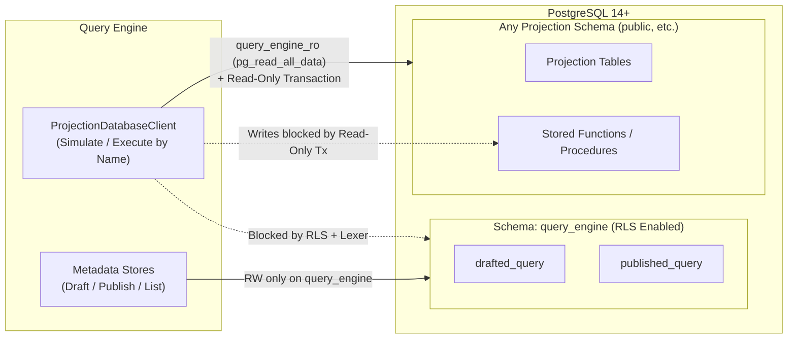

# Query Engine — Schema Isolation & SELECT-Only Reference

> **Superseded (2026-10-27).** This describes an earlier design with a separate `query_engine` schema, a read-write engine role and a
> read-only `query_engine_ro` role. The engine now uses one datasource and one table, `qe_stored_query`, and keeps author SQL read-only with
> `BEGIN READ ONLY` plus the SQL guard. See `docs/security_protocol.md` and the PRD, "Query lifecycle". Kept for reference.

Last updated: 2026-10-25

## 1. Core Responsibilities of `query-engine`

`query-engine` has two distinct responsibilities:

1. **Design-Time (`draft` → `simulate` → `publish`):**
   Allow defining, simulating, and publishing read-only queries (`SELECT`) while enforcing all static and runtime checks required to prevent any explicit or implicit modification to the database/projections.
2. **Run-Time (`POST /data-query`):**
   Execute an already-published query strictly by its defined `name` and bound `params`. Because `draft`, `simulate`, and the `publish` pre-check already verify the query before publication, `/data-query` does not need to re-evaluate what the SQL template allows at invocation time.

---

## 2. Schema & Role Separation (Zero Per-Schema Maintenance)

To keep complete separation of concerns without maintaining schema-by-schema access control lists (`public` or any other DBA-managed schema):

- **`query_engine` Schema:** `query-engine` owns a dedicated schema `query_engine` containing its internal tables (`drafted_query`, `published_query`, `realm_role`, `realm_group`).
- **Projection Schemas:** Projection tables stay in `public` or any other schema defined by a DBA or the host Query Service.
- **Role & Connection Model:**
  - **Engine Metadata Role (`query_engine`):** Has Read-Write (RW) access **only** to the `query_engine` schema (`AUTHORIZATION query_engine`).
  - **Projection Execution Role (`query_engine_ro`):** Used on `ProjectionDatabaseClient` to execute user SQL templates. Granted PostgreSQL 14+'s built-in `pg_read_all_data` so it can `SELECT` from any projection schema without specifying schemas one by one, while having **zero write privileges** anywhere.



---

## 3. PostgreSQL Access Control Reference

```sql
-- 1. Engine metadata role: owns ONLY the query_engine schema (RW confined to query_engine)
CREATE ROLE query_engine WITH LOGIN PASSWORD 'query_engine'
    NOSUPERUSER NOCREATEDB NOCREATEROLE NOREPLICATION NOBYPASSRLS;

CREATE SCHEMA IF NOT EXISTS query_engine AUTHORIZATION query_engine;
REVOKE ALL ON SCHEMA query_engine FROM PUBLIC;

-- 2. Read-only role for executing queries against projections
CREATE ROLE query_engine_ro WITH LOGIN PASSWORD 'query_engine_ro'
    NOSUPERUSER NOCREATEDB NOCREATEROLE NOREPLICATION NOBYPASSRLS;

-- Grants USAGE on all schemas and SELECT on all tables/views automatically
-- without naming public or other projection schemas one by one; grants NO write rights.
GRANT pg_read_all_data TO query_engine_ro;

-- Default every session of this role to read-only transactions
ALTER ROLE query_engine_ro SET default_transaction_read_only = on;

-- Prevent PUBLIC from creating objects in public or flipping session config via set_config
REVOKE CREATE ON SCHEMA public FROM PUBLIC;
REVOKE EXECUTE ON FUNCTION pg_catalog.set_config(text, text, boolean) FROM PUBLIC;

-- 3. Prevent pg_read_all_data from reading query_engine's internal tables:
--    The table owner (query_engine) bypasses RLS automatically; query_engine_ro has NOBYPASSRLS
--    and hits default-deny (no policy defined).
ALTER TABLE query_engine.drafted_query   ENABLE ROW LEVEL SECURITY;
ALTER TABLE query_engine.published_query ENABLE ROW LEVEL SECURITY;
ALTER TABLE query_engine.realm_role      ENABLE ROW LEVEL SECURITY;
ALTER TABLE query_engine.realm_group     ENABLE ROW LEVEL SECURITY;
```

### Key PostgreSQL Behaviors Clarified

1. **Does `GRANT pg_read_all_data TO query_engine_ro` allow RW on `query_engine`?**
   - **No.** `pg_read_all_data` only grants `USAGE` on schemas and `SELECT` on tables/views/sequences. It grants zero write (`INSERT`, `UPDATE`, `DELETE`, `TRUNCATE`, DDL) privileges anywhere.
2. **What does `REVOKE ALL ON SCHEMA query_engine FROM PUBLIC;` do?**
   - `PUBLIC` is PostgreSQL's pseudo-role representing all database users. Revoking `ALL` from `PUBLIC` ensures arbitrary users do not get `USAGE` or `CREATE` privileges on the `query_engine` schema.
   - Because `pg_read_all_data` bypasses schema/table ACLs for `SELECT`, enabling Row-Level Security (`ENABLE ROW LEVEL SECURITY`) on `query_engine.*` tables (combined with the SQL lexer blocking `query_engine.` references) prevents `query_engine_ro` from reading internal engine tables.
3. **Why use both the `query_engine_ro` role AND read-only transactions?**
   - **`query_engine_ro` (ACL layer):** Enforces read-only access at the permission level and cannot be turned off by session parameters. However, ACLs on the caller do not stop a `SECURITY DEFINER` stored function (which executes with the function owner's permissions) from mutating projection tables.
   - **Read-only transaction (`default_transaction_read_only = on` / `BEGIN READ ONLY`):** Applies across the entire call stack—including inside `plpgsql` and `SECURITY DEFINER` functions—and immediately aborts any internal `INSERT`, `UPDATE`, `DELETE`, `CREATE TEMP TABLE`, `nextval()`, or `setval()` with `SQLSTATE 25006 (read_only_sql_transaction)`.
4. **Can `SELECT set_config('default_transaction_read_only', 'off', false)` undo `default_transaction_read_only = on` for subsequent pooled queries?**
   - **Yes**, unless blocked: PostgreSQL allows `set_config` inside a read-only transaction because it is a session setting, and `is_local = false` persists on the pooled connection.
   - **Mitigation:**
     1. Revoke `EXECUTE ON FUNCTION pg_catalog.set_config(text, text, boolean) FROM PUBLIC` (or wrap each projection execution in an explicit `BEGIN READ ONLY` transaction).
     2. Block `set_config`, `SET`, and `RESET` in the design-time SQL validator.

---

## 4. Design-Time Checks (`draft` → `simulate` → `publish`)

1. **Draft (`QueryValidator` / SQL Lexer):**
   - Tokenizes the SQL template (skipping comments, string literals, dollar-quoted blocks, quoted identifiers, and `::type` casts).
   - Rejects non-`SELECT` statements, multiple statements (`;`), write/admin keywords (including inside `WITH` CTEs), `SELECT INTO`, locking clauses (`FOR UPDATE` / `FOR SHARE`), references to `query_engine.*` internal tables, and side-effect/session functions (`set_config`, `nextval`, `setval`, `pg_sleep*`, `pg_terminate_backend`, `lo_*`, `dblink*`, `query_to_xml*`, `table_to_xml*`).
2. **Simulate (Runtime Read-Only Probe):**
   - Runs the `SELECT` query over `ProjectionDatabaseClient` (`query_engine_ro` + read-only transaction). Any stored function attempting an implicit write fails with `SQLSTATE 25006` / `42501`, preventing `simulated` from becoming `true`.
3. **Publish Pre-Check:**
   - Verifies `simulated = true` and re-validates the draft before writing to `query_engine.published_query`.
