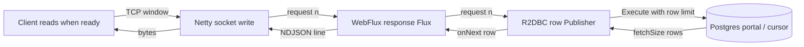
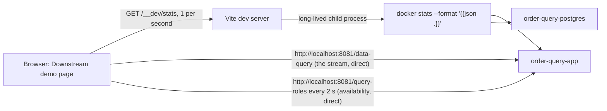

# Reactive R2DBC + database cursor: backpressure for `/data-query`

Status: **implemented 2026-10-18** (backend and UI), verified as listed under "Spike findings". Section 2 describes the code as it
was before this work; sections 4 to 6 describe what was built. Not exercised in a real browser (see findings). Related: `docs/Policy-Compiled Query DSL Service — Implementation PRD.md` ("Current implementation
(as built)") and `docs/PROGRESS.md`.

## 1. Purpose and scope

The engine is reactive (WebFlux + R2DBC) so that a slow client slows the database read instead of the server buffering
rows. A client app that pulls order history in batches of 100 should cost the service a bounded amount of memory and a
bounded amount of database connection time, no matter how many rows the query matches.

In scope:
- Streaming `/data-query` results with demand-driven reads from Postgres (R2DBC statement `fetchSize`, which makes
  Postgres serve the result through a cursor).
- An optional `fetchSize` per query, set in the query definition.
- Resource guards so slow or stuck clients cannot exhaust the service or the database.
- A 50,000-row demo dataset in `order-query` and a UI page in `query-builder-ui` that acts as a slow downstream
  service, so the behaviour can be shown to management.

Out of scope (not built): keyset pagination and `X-Next-Cursor` (proposed in section 10), result shape or arity, OPA and field
redaction, jOOQ, `X-Redacted-Fields`, authentication. The PRD describes some of these; the code does not have them.

## 2. Where we are today

- `ProjectionStoreExecutor.execute` calls `.all().collectList()`: every matching row is read from Postgres into memory
  before the first byte is sent, and `DataQueryController` returns the `List` as `application/json`.
- The 200-row cap (`ROW_CAP`) is applied after that full read, and `QueryEngineService.invoke` drops the `truncated`
  flag. A client with 500 matching rows silently receives 200 and cannot tell.
- `simulate` uses the same method, so a simulate on a query matching a million rows reads a million rows and returns 200.
- The statement `fetchSize` is never set. All stores and the executor share one Boot-autoconfigured pool
  (`spring.r2dbc.pool.max-size=20` in each service).
- Library versions (resolved from `order-query`): Spring Boot 4.1.1 BOM, reactor-core 3.8.7, reactor-netty 1.3.7,
  r2dbc-postgresql 1.1.2, r2dbc-pool 1.0.2, r2dbc-spi 1.0.0, Netty 4.2.17, Jackson 3 (`tools.jackson`). Behaviour
  assumptions below come from older versions and are confirmed or corrected in the Phase 0 spike.

## 3. How backpressure works end to end



A slow client stops reading, so the TCP window fills and Netty stops writing. WebFlux stops requesting rows, R2DBC stops
asking Postgres for the next batch, and Postgres stops producing. Anything that buffers in the middle breaks the chain:

- `collectList()` or any operator that gathers the whole result (today's executor).
- A `Flux<Map>` returned as `application/json`. As remembered, the Jackson encoder gathers a non-streaming `Flux` into one
  list; streaming needs `application/x-ndjson`. To be confirmed in the spike.
- `onBackpressureBuffer`, large `prefetch` values, or `Flux.cache`.
- A gateway or proxy that buffers the response (the stream then looks fast to the service and the pacing is lost).

### Three different "batch sizes"

| Name | Where | Who sets it |
| --- | --- | --- |
| Fetch size | Rows per round trip between the service and Postgres (statement `fetchSize`) | Query author (optional) or service default |
| Transport buffers | Bytes held in kernel socket buffers, Netty, Reactor and the client's network stack between the two ends | Not configured; measured in the spike |
| Consumer batch | Rows a downstream service processes at a time (100 in the demo) | The client app; the server never sees it |

The rows read from Postgres ahead of what the client has consumed are roughly one fetch size plus whatever the transport
buffers hold. That is why the demo dataset uses wide rows (section 5): the total volume must be much larger than the
buffers for the pacing to be visible.

### What the cursor is

With R2DBC, calling `Statement.fetchSize(n)` makes the driver run the query as a portal and fetch `n` rows at a time,
fetching the next batch only when downstream demand needs it, instead of letting Postgres push the whole result. We apply
it through the `DatabaseClient` statement filter. Whether r2dbc-postgresql 1.1.2 does exactly this under autocommit, and how
far it reads ahead, is the first thing the spike measures. Without `fetchSize`, the server sends everything and the driver
applies TCP-level flow control only.

## 4. Design

### 4.1 HTTP contract

`POST /data-query` keeps its body (`{ name, params }`) and the `X-Roles` header. The response format is chosen by `Accept`.

| `Accept` | Response | Row limit |
| --- | --- | --- |
| `application/x-ndjson` | `200`, `Content-Type: application/x-ndjson`, one JSON object per row, one row per line, no envelope. An empty result is `200` with an empty body | None (bounded only by the guards in 4.5) |
| `application/json`, `*/*`, or absent | `200`, JSON array, exactly as today | `json-max-rows` (default 1000). More rows gives `413 RESULT_TOO_LARGE` with a message pointing to NDJSON |
| anything else | `406` | n/a |

Streaming responses also carry `Cache-Control: no-store` and `X-Accel-Buffering: no` so gateways do not buffer them.

Behaviour change to flag: today a query matching more than 200 rows is silently cut to 200. After this change the JSON mode
returns up to 1000 and fails loudly above that. Clients that need more must read NDJSON.

### 4.2 Request pipeline

1. Resolve the name, load the published query, check the caller's roles, check the params. These are the same steps as
   today and fail with the same codes (`404`, `403`, `400`).
2. Acquire a projection connection (bounded wait) and execute the statement with the effective fetch size.
3. The first row decides the response: everything that can fail cheaply (steps 1, a pool timeout, and Postgres rejecting
   the SQL, such as a missing column) fails before any byte is written, so it still produces a normal JSON error with the
   right status. To be confirmed: that such a failure surfaces before the first row and before the response is committed.
4. After the first byte, status and headers are fixed, so failures are signalled by aborting the connection (4.3).

### 4.3 Error contract

| Situation | Detected | Result |
| --- | --- | --- |
| Unknown query | before first byte | `404 QUERY_NOT_FOUND` (existing) |
| Caller not allowed | before first byte | `403 FORBIDDEN` (existing) |
| Missing or mistyped param | before first byte | `400 INVALID_ARGUMENT` (existing) |
| Postgres rejects the SQL (bad column, syntax) | before first row | `500 QUERY_EXECUTION_FAILED`; the message carries the SQLSTATE only, full detail goes to the log (proposed) |
| No pooled connection within the acquire timeout | before first byte | `503 SERVICE_BUSY` with `Retry-After` (proposed) |
| `statement_timeout` hit before the first row | before first byte | `504 QUERY_TIMEOUT` (proposed) |
| JSON mode over the cap | before the body is written | `413 RESULT_TOO_LARGE` |
| Database error, stall timeout, maximum duration or statement timeout after the first row | mid-stream | Connection aborted; the log records the outcome. Standard HTTP clients report an incomplete transfer (curl exit 18; the browser's stream read rejects) |
| Client disconnects | any time | Stream cancelled, connection released, logged as `cancelled` |

Two rules: a timeout must **raise an error, never complete the stream**, because a stream that ends cleanly looks like
success to the client (Reactor's `take(Duration)` does exactly that, so it is not used for guards). And error responses
must stay JSON even when the request asked for `application/x-ndjson`; the spike confirms how Spring negotiates that.

### 4.4 Per-query `fetchSize`

An optional integer on the query definition, next to `sql` and `params`. It is set when drafting (not at publish like
`allowed_roles`) because it is an execution property of the query and simulate should exercise it.

Example entry (the demo query):

```yaml
queryName: orders.historyByDate
sql: |-
  SELECT order_id, customer_id, branch_id, status, channel, customer_tier, order_date, total, notes
  FROM order_history_projection
  WHERE order_date >= :since
  ORDER BY order_id
params:
  since: date
fetchSize: 100
```

Rules:
- Absent means the service default (`query-engine.stream.fetch-size`, 500).
- Valid range is 1 to `query-engine.stream.max-fetch-size` (10,000). Outside it, the draft is saved with status `DRAFT` and
  an `INVALID_FETCH_SIZE` error, like the other draft problems. A value that is not an integer is rejected when the
  request is decoded.
- Effective value: streaming mode uses it as is. JSON mode and simulate use `min(effective, cap + 1)` so they never read
  far past their row limit.
- It is a database batch size, not a page size for the client. Clients cannot change it per request.

Where it flows:

| Layer | Change |
| --- | --- |
| API | `fetchSize` (camelCase, like `queryName`) in the draft body and YAML; echoed in `DraftResponse.entry` and in the list's published summary |
| Model | `QueryEntry`, `ValidatedQuery` and `DraftRequest` gain a nullable `Integer fetchSize` |
| Validation | `QueryValidator` range check, error code `INVALID_FETCH_SIZE` |
| Persistence | `fetch_size INT NULL` on `query_draft` and `published_query`, added by `ALTER TABLE … ADD COLUMN IF NOT EXISTS` in `schema.sql` (it runs on every start, so existing databases keep working). A column is needed because a draft with errors has no `validated_query` to carry it, and resuming an edit must not lose it |
| Executor | `spec.filter(stmt -> stmt.fetchSize(n))` with the effective value |
| UI | `yaml.js` reads `queryName`, `sql`, `params` only and `entryToYaml` writes only those, so without a small pass-through, editing a draft in the wizard would silently drop `fetchSize`. No new screens |
| Files | `.http` examples with `fetchSize` |

### 4.5 Resource protection

A stream holds a pooled database connection for as long as the client takes to read it. The guards bound that.

| Guard | Default | Property |
| --- | --- | --- |
| Pool acquire timeout, then `503` | 3s | `query-engine.stream.acquire-timeout` |
| Postgres `statement_timeout` on projection connections | 60s | `query-engine.stream.statement-timeout` |
| Stall timeout (no row delivered because the client stopped reading) | 30s | `query-engine.stream.stall-timeout` |
| Maximum stream duration (also bounds how long an old database snapshot is held) | 10 min | `query-engine.stream.max-duration` |
| JSON mode row cap | 1000 | `query-engine.stream.json-max-rows` |
| Default fetch size / maximum per-query value | 50 / 10,000 | `query-engine.stream.fetch-size`, `query-engine.stream.max-fetch-size` |
| Simulate row cap (today's `ROW_CAP`) | 200 | `query-engine.simulate.max-rows` |

Client disconnect cancels the subscription, which closes the portal and returns the connection.

Separate projection pool, to be decided after the spike. Option A keeps one pool with the acquire timeout. Option B adds a
dedicated pool for projection reads so the engine's own calls (the published-query lookup that begins every `/data-query`,
and the authoring endpoints, which live in the same service) cannot be starved by slow streams. Boot's R2DBC auto-config is
expected to back off as soon as another `ConnectionFactory` bean exists, so B means declaring both pools explicitly or
keeping the projection pool outside the bean graph; this needs checking. Choose B if the spike shows engine calls waiting
while streams hold the pool. B also leaves room to point projection reads at a read replica later.

### 4.6 Observability

One structured log line per `/data-query`: query name, caller roles, mode (`ndjson` or `json`), outcome (`completed`,
`cancelled`, `error`, `timeout`, `capped`), rows, duration, effective fetch size. No new tables or metrics stack.

## 5. Demo dataset (`order-query`)

A new table, `order_history_projection`, 50,000 rows, loaded by Postgres init from
`order-query/docker/init/02_order_history_projection.sql`. It is separate from `order_projection` so the existing sample
queries and their documented results are untouched and the simulate cap is not filled by sample data.

| Column | Type | Spread |
| --- | --- | --- |
| `order_id` | `VARCHAR(16)` PK | `H-000001` to `H-050000` |
| `customer_id` | `VARCHAR(16)` | about 5,000 distinct |
| `branch_id` | `INT` | 3, 5, 7, 9, 12, 21 |
| `status` | `VARCHAR(32)` | the same seven values as `order_projection`, weighted |
| `channel` | `VARCHAR(16)` | WEB, MOBILE, POS, CALL_CENTER |
| `customer_tier` | `VARCHAR(16)` | GOLD, SILVER, BRONZE |
| `order_date` | `DATE` | 2026-01-01 to 2026-10-12 |
| `total` | `NUMERIC(12,2)` | 5.00 to about 500.00 |
| `notes` | `TEXT` | deterministic filler of about 500 characters |

- **Deterministic:** generated with `generate_series(1, 50000)` and arithmetic on the series value (`g % n` lookups,
  `repeat(md5(g::text), 16)` for `notes`), never `random()`, so every load is identical and results can be compared
  between runs. Followed by `ANALYZE`.
- **Wide rows on purpose:** about 700 bytes per row as NDJSON, so the full result is about 70 MB. Socket and client buffers
  hold a few MB, so a slow consumer stalls the stream long before the data is all in flight.
- **Persistence:** the script is committed, so the dataset is reviewable and reloadable. It loads on a fresh volume, like
  the existing seeds. `./stop.sh` removes the volume and the next `./dry-run.sh` reloads it.

## 6. Downstream slow-consumer demo (`query-builder-ui`)

This replaces the earlier idea of a single-file Java client. The UI page is the downstream service: a real HTTP client
that pulls the list and processes it 100 rows at a time with a delay per batch, so the whole path (browser, dev-server
proxy, service, R2DBC, Postgres) is exercised over HTTP.

**Navigation.** The top bar gains a link next to the domain switcher: "Downstream demo", route
`/:domainKey/downstream-demo`. It is driven by a `streamDemo` entry in `src/domains.js` (query name, `since` value,
expected row count, default role), present only on the Order domain, because the dataset lives in `order-query`. Other
domains do not show the link. Opening the page starts the stream automatically.

**The pre-configured query** is `orders.historyByDate` (the entry in 4.4), called with `since = 2026-01-01`, which matches
all 50,000 rows, as the `data-platform` group. On opening, the page checks the domain's list. If the query is published it
is reused (using the first of its allowed roles). If not, the page drafts, simulates and publishes it itself, shown as a
"Preparing demo query" step, so one click works on a fresh database. If a draft is held by another author, the page shows
that error instead.

**Consumption loop.** `fetch` with `Accept: application/x-ndjson` and `X-Roles`, then `response.body.getReader()`. Lines
are parsed into a pending list. The loop only calls `reader.read()` while fewer than one batch of rows is pending, and it
awaits the delay between batches. While it sleeps nothing reads, so the browser's buffers fill, TCP flow control engages,
and the service and database slow down. The page keeps counters and the current batch only, never all rows, otherwise the
browser would become the buffer.

**Screen.**
- Controls: batch size (default 100), delay per batch in ms (default 100, giving a run of about 50 seconds), Start/Restart
  and Stop. Settings are locked while running.
- Progress bar: processed rows against the expected 50,000.
- Stats: received, processed, work in progress (rows in the batch being processed), batches done, elapsed, rows per
  second, time to first row, and state (preparing, connecting, receiving, processing batch k, done, stopped, failed).
- Current batch: its row range and a few `order_id`s, with a small bar for the simulated processing time.
- Log: the last ten events in the style of a console, for example `batch 17 received rows 1601-1700 | work in progress: 100`
  followed by `batch 17 done | processed 1700 | 3.4s | 500 rows/s`.
- Result: when the stream ends, PASS or FAIL for the checks in AC-3 (exact count, ascending `order_id`, no duplicates or
  gaps).
- Review aids (collapsed, with copy buttons): `docker stats order-query-app`, and a `psql` query on `pg_stat_activity`
  filtered to `order_history_projection` showing the stream's backend while the page is processing.

**Lifecycle.** Stop, leaving the page, or switching domain aborts the request. That cancels the stream on the server and
releases the connection, which is itself part of the demonstration. In development, React StrictMode starts the page twice;
the first request is aborted at once and shows up as one `cancelled` line in the service log.

**Plumbing.** `engineClient.js` gains a `stream(...)` function that reuses the existing error normalization before the
body is read, so a `403`, `404` or `503` appears as a normal error on the page. The browser now calls the service
directly (the dev-server proxy was removed, see `PROGRESS.md`, "Direct service calls"), so nothing in between buffers the
response. A built `dist/` served behind a reverse proxy would need response buffering switched off (`proxy_buffering off`
in nginx).

Memory-limited review run: a compose override file, `order-query/docker/docker-compose.lowmem.yml`, sets
`JAVA_TOOL_OPTIONS=-Xmx192m` and a container memory limit for the service, so a flat footprint during the 70 MB stream is
visible in `docker stats`. The default compose files are not changed.

## 7. Implementation phases

Phase 3 and 6 depend on 0 to 2; the order below is the build order.

| Phase | Work | Exit criteria |
| --- | --- | --- |
| 0. Dataset and spike | Add the dataset script. Throwaway experiments (not committed) to resolve U1 to U9 below and measure read-ahead with a stalling client. Record findings in section 9 | Dataset loads 50,000 rows with a stable checksum (`md5(string_agg(order_id, ',' ORDER BY order_id))` identical across loads); each unknown has a recorded answer; the design in section 4 is adjusted if an assumption was wrong |
| 1. Streaming executor | `stream(...)` returning `Flux<Map>` with fetch size; rebuild the bounded `execute` (simulate, JSON mode) on it with `take(cap + 1)` so it cancels early; overflow detected from the extra row | `StepVerifier` tests: demand-limited requests, cancel propagation, overflow flag; simulate on a 50K-row query returns 200 rows with `truncated = true` without reading the rest |
| 2. `fetchSize` in the definition | DTOs, validator, persistence and migration, list summary, `.http` examples, UI YAML pass-through | AC-11 |
| 3. Endpoint | `Accept` negotiation, pre-first-byte errors, NDJSON writer, headers, `413` | AC-3, AC-7, AC-9, AC-12, AC-14 |
| 4. Resource protection | Pool decision (A or B), acquire timeout and `503`, `statement_timeout`, stall timeout, max duration, cancel handling | AC-4, AC-5, AC-6, AC-8 |
| 5. Observability | The per-request log line | AC-15 |
| 6. UI demo | Nav link, page, `stream(...)` client function, demo query setup, domain config | AC-16, AC-17 |
| 7. Acceptance run and docs | Low-memory compose override, the full acceptance run, `curl -N` examples, update the PRD Phase 2 text and `docs/PROGRESS.md` | All criteria below pass; results recorded in section 9 |

## 8. Acceptance criteria

Numbers in angle brackets are starting points to be confirmed by the spike.

| ID | Scenario | How verified | Pass condition |
| --- | --- | --- | --- |
| AC-1 | Constant memory with a slow reader | Low-memory override (192 MB heap); demo page at 100 rows per 100 ms over all 50,000 rows; sample `docker stats` throughout | All 50,000 rows delivered, no out-of-memory or GC thrash, service memory does not grow with rows delivered (stays within <64 MB> of its pre-stream level) |
| AC-2 | Database paced by the client | Same run; query `pg_stat_activity` while the page is in its processing delay | The stream's backend is not producing during the delay; the read-ahead (rows fetched minus rows consumed) stays at most `fetchSize` plus the transport buffers measured in the spike (<N> rows) |
| AC-3 | Completeness and order | Demo page result banner | Exactly 50,000 rows, `order_id` strictly ascending, no duplicates or gaps |
| AC-4 | Client disconnect | Stop button, closing the tab, and `curl` killed mid-stream | Within <5 s> the connection is back in the pool and Postgres shows no active stream; the log records `cancelled` |
| AC-5 | Stalled client | Script that opens the stream and stops reading | Cut at the stall timeout; connection released; log records `timeout` |
| AC-6 | Pool saturation | Pool-size slow streams plus one extra caller; with option B also a `/data-query` for a query the caller cannot run | The extra caller gets `503` with `Retry-After` within the acquire timeout plus <1 s>; running streams continue; the forbidden call returns `403` in under <1 s> (option B) |
| AC-7 | Bad SQL | Publish a query with a missing column and call it with both `Accept` values | JSON error with status `500 QUERY_EXECUTION_FAILED`, never a `200` stream |
| AC-8 | Database failure mid-stream | `pg_terminate_backend` on the stream's backend | Client sees an aborted transfer (curl exit 18; the page shows "stream aborted"), not a clean end; log records `error` |
| AC-9 | Bounded JSON mode | A query matching more than 1000 rows with default `Accept`; one with 1000 or fewer | Over the cap: `413 RESULT_TOO_LARGE` quickly, with at most cap + 1 rows read; at or under: unchanged output |
| AC-10 | Simulate stops early | Simulate a query matching 50,000 rows | 200 rows, `truncated = true`, returned in <1 s>, and the backend is released |
| AC-11 | Per-query `fetchSize` | Draft with `fetchSize: 50`; out-of-range values; absent value; resume and re-save in the wizard | 50 is accepted, persisted through draft, resume, publish and list, and survives a wizard edit; `0`, negative and above max give `DRAFT` with `INVALID_FETCH_SIZE`; absent uses the default; a stub-`Statement` unit test sees `fetchSize(effective)` |
| AC-12 | Errors under NDJSON | `403`, `404` and `400` requests with `Accept: application/x-ndjson` | Correct status with a JSON `{ error, message, queryName }` body |
| AC-13 | Small queries not slower | Existing 24-row queries, before and after | Median latency within <20 ms> |
| AC-14 | Existing flows unchanged | Wizard, Run dialog, `.http` files | They work as before in JSON mode |
| AC-15 | Observability | Each scenario above | One log line per request with outcome and row count matching what happened |
| AC-16 | Demo page behaviour | Manual | Opens and starts by itself; Start/Stop work; leaving the page cancels the request; the page keeps counters and one batch only (browser memory stays flat) |
| AC-17 | Demo query setup | Open the page on a fresh database, then again | First visit publishes the query and streams; second visit reuses it without republishing |

## 9. Test strategy, decisions, risks

**Tests.**
- Unit, no database: `StepVerifier` against a fake row source for demand, cancel, cap and timeout behaviour; a stub R2DBC
  `Statement` for `fetchSize`; validator tests for `INVALID_FETCH_SIZE`.
- Acceptance, real services: Docker Compose stacks as used throughout, with the low-memory override for AC-1, and small
  scripts for AC-5, AC-6 and AC-8.
- Demo: the UI page, run by hand for management and for AC-1 to AC-4.

**Decisions (the recommendations were accepted on 2026-10-17).**
1. Over the JSON cap: `413 RESULT_TOO_LARGE`, not silent truncation.
2. Mid-stream failure: abort the connection, no marker line in the stream.
3. Separate projection pool: decided after the spike, using the criterion in 4.5.
4. Starting values: the defaults in 4.5, all configurable. `fetchSize` is overridable per query.
5. Dataset: a committed, deterministic script, reloaded on a fresh volume; `./stop.sh` still resets the databases.
6. The UI page prepares the demo query itself and idempotently.
7. The UI YAML pass-through for `fetchSize` is included.
8. The downstream demo is a UI page, replacing the single-file Java client.

**Unknowns to settle in the spike.**

| ID | Question |
| --- | --- |
| U1 | Does `fetchSize` through `DatabaseClient` give demand-driven fetching in r2dbc-postgresql 1.1.2 under autocommit, and how far does it read ahead? |
| U2 | Does a `Flux<Map>` with `application/x-ndjson` stream without gathering (Jackson 3, this Spring version), and does `application/json` gather? |
| U3 | What status and body do error handlers produce when the request has `Accept: application/x-ndjson`? |
| U4 | Does a Postgres error such as a missing column surface before the response is committed, so the status can still be set? |
| U5 | Does an error after the first byte abort the connection without a terminating chunk (curl exit 18)? |
| U6 | Does a client disconnect release the pooled connection and end the Postgres backend's work? |
| U7 | Does adding a second `ConnectionFactory` disable Boot's auto-configured one (affects option B)? |
| U8 | How far ahead of a paused browser consumer do bytes and rows move through the Vite proxy and Docker's published port? |
| U9 | How is `statement_timeout` set per connection with r2dbc-postgresql 1.1.2? |

**Dataset size note:** the spike below was measured on the first version of the dataset, 100,000 rows. It was later reduced to 50,000 rows (`generate_series(1, 50000)`); the findings about read-ahead, memory and behaviour do not depend on the row count, but the row counts and timings quoted are from the 100,000-row run and have not been re-measured.

**Spike findings (measured 2026-10-18, order-query in Docker, Postgres 14, 100,000-row dataset).**

- U1 (fetchSize): works. With `log_statement=all`, Postgres logs one `execute` for the query and then one `execute fetch from
  S_0/B_1` per `fetchSize` rows (100 here), so the cursor is read in portions as the client demands them. A consumer that took
  6,000 rows in 6 s caused 197 fetches (19,700 rows) and the same run for 14 s caused 284 (28,400 rows vs 13,800 consumed).
  So the read-ahead is a fixed bound of about 14,600 rows (about 8 MB of text) between the consumer and Postgres, not a
  growing buffer. It is made of socket buffers and the reactor/netty queues in the chain (Postgres, service, Docker port
  forward, Vite proxy). Fetching stops when the consumer stops: 0 further fetches in the 3 s after the client disconnected.
- U2 (NDJSON streaming): works. `Flux` with `application/x-ndjson` streams row by row. A full 100,000-row pull takes about 2 s
  and the container stayed within `-Xmx192m` / 320 MB (265 MiB RSS), also with 6 concurrent full pulls. `application/json` is
  gathered, which is why it has a row cap.
- U3 (error content type): fixed by setting `application/json` explicitly on every error response. 403 and 400 under
  `Accept: application/x-ndjson` return a JSON body with the right status. An unsupported `Accept` such as `text/html`
  returns 406 with Spring's default page, not an engine error body.
- U4 (error before first byte): 400 `INVALID_ARGUMENT` (bad date) and 403 arrive as normal JSON errors with the correct status
  under NDJSON. A Postgres error before the first row (bad column) was not separately re-tested in this pass; the
  executor classifies it as `QUERY_EXECUTION_FAILED` and the same path applies.
- U5 (error after first byte): works. `pg_terminate_backend` mid-stream ended the transfer with curl exit 18 (incomplete
  transfer) after 12,416 rows and the service logged `outcome=error`. The stall guard did the same live once (see below). Both
  also log a noisy `UnsupportedOperationException` at ERROR from Spring, because the exception handler tries to write an error
  body to a committed response. It is harmless but should be suppressed.
- U6 (disconnect releases the connection): works. After killing 25 slow clients, all backends were back to `idle`. Aborting
  the browser-side request is logged as `outcome=cancelled`.
- U7 (second ConnectionFactory): not needed. The projection pool lives inside `ProjectionDatabaseClient` and is not exposed as a
  bean, so Boot's auto-configuration is untouched.
- U8 (browser/proxy read-ahead): measured with a Node consumer through the Vite proxy (`localhost:5173`), 100 rows then 100 ms:
  ordered, no gaps, same read-ahead bound as above. A real browser was not used, so browser fetch internals are unverified.
- U9 (`statement_timeout`): passed as a connection option through `ProjectionDatabaseClient`. Later finding (2026-10-19): Postgres
  applies it to the whole cursor read, not to each fetch, so every stream longer than the timeout (60 s default) is cancelled
  with `QUERY_TIMEOUT`, even when the client is healthy but slow. A 100,000-row run at 1,000 rows/s hit it at about 62 s. The
  4.5 table listing 60 s as a stream guard is therefore wrong for streams; it needs a separate decision (see PROGRESS.md, open
  issue 1). The service also hides this from browsers when they connect through the Vite dev proxy, which does not
  propagate an upstream abort.

Other results: pool saturation (25 slow readers against a pool of 20) gives `503 SERVICE_BUSY` with `Retry-After: 2` while
`/engine/list` stays fast (46 ms). The JSON cap gives `413 RESULT_TOO_LARGE`. Simulate on the 100,000-row query returns in
about 50 ms with 200 rows. `StreamGuards` has unit tests with virtual time.

Open observation: in one run, immediately after recreating the container, the first full pull stalled at 14,192 rows and the
30 s stall guard aborted it (`STREAM_STALLED`). It did not reproduce in about 20 further runs (restarts, force-recreates, 6
concurrent pulls). Cause unknown; treat it as unexplained. The guard itself behaved as designed.

**Risks.**
- The demo may show less pacing than expected if transport buffers are larger than assumed (U8). Mitigation: the wide rows,
  and measuring rather than claiming a number.
- Streams hold a snapshot and a connection; the guards in 4.5 bound it but their defaults are guesses until measured.
- Behaviour change in JSON mode (4.1) can surprise existing callers that relied on silent truncation at 200.
- Published SQL runs with the service's full database rights, including writes. A read-only projection connection would fix
  that and fits naturally with option B, but it is a separate decision.

## 10. Alternative: keyset pagination with `X-Next-Cursor` (proposal, not built)

Status: a design to compare against sections 3 to 9. Nothing here exists in the code. It was not measured; where this section
says how Postgres should behave, that is an expectation to check, not a result.

### 10.1 The idea in one minute

Database-cursor streaming (what we built) keeps **one long request** open and one database connection busy while the client
reads. Keyset pagination does the opposite: the client makes **many short requests**. Each one returns a page of rows, plus a
bookmark saying where the page ended. The client sends the bookmark back to get the next page.

The bookmark is the value of the sort key of the last row sent. The next query says "give me rows after this key" instead of
"skip N rows":

```
OFFSET paging (slow, drifts):   ... ORDER BY order_id OFFSET 90000 LIMIT 100   -- Postgres reads and discards 90,000 rows
Keyset paging (fast, stable):   ... WHERE order_id > 'H-090000' ORDER BY order_id LIMIT 100   -- index seek, reads 100 rows
```

Between requests the service holds nothing: no connection, no transaction, no cursor. All the state is in the bookmark.

### 10.2 What a client sees

The demo query again (`orders.historyByDate`, ordered by `order_id`), page size 3 to keep it readable. Real pages would use
100 to 1000.

Request 1: no cursor.
```
POST /data-query
Content-Type: application/json
Accept: application/x-ndjson
X-Roles: data-platform

{ "name": "orders.historyByDate", "params": { "since": "2026-01-01" }, "page": { "size": 3 } }
```
Response 1:
```
HTTP/1.1 200 OK
Content-Type: application/x-ndjson
X-Next-Cursor: eyJ2IjoxLCJrIjpbIkgtMDAwMDAzIl19

{"order_id":"H-000001", ...}
{"order_id":"H-000002", ...}
{"order_id":"H-000003", ...}
```
Request 2: the same call plus the cursor from the header.
```
{ "name": "orders.historyByDate", "params": { "since": "2026-01-01" }, "page": { "size": 3, "cursor": "eyJ2IjoxLCJrIjpbIkgtMDAwMDAzIl19" } }
```
Response 2 holds `H-000004` to `H-000006` and a new `X-Next-Cursor`. On the last page the header is **absent**, which tells the
client it is done. (Check that the cursor above decodes to `{"v":1,"k":["H-000003"]}`: it is just base64url JSON.)

The client loop is short:
```
cursor = null
do {
  res = POST /data-query { name, params, page: { size: 1000, cursor } }
  process(res.rows)                       // at the client's own pace
  cursor = res.headers['X-Next-Cursor']   // null on the last page
} while (cursor)
```

### 10.3 The SQL

The author's published query stays as it is. The engine wraps it for the page and adds the bookmark condition. For
`orders.historyByDate` the engine would run (page 2, size 3):

```sql
SELECT *
FROM (
  SELECT order_id, customer_id, branch_id, status, channel, customer_tier, order_date, total, notes
  FROM order_history_projection
  WHERE order_date >= :since
) q
WHERE q.order_id > :cursor_order_id          -- omitted on the first page
ORDER BY q.order_id
LIMIT :page_size_plus_one                    -- size + 1, see below
```

- **Fetching size + 1:** if the database returns size + 1 rows, there is a next page, so the service sets `X-Next-Cursor` from the
  key of row number `size`, and drops the extra row. If it returns size or fewer, there is no next page and no header. This
  avoids a final empty request.
- **Several key columns:** use a row comparison, `WHERE (q.order_date, q.order_id) > (:c_order_date, :c_order_id) ORDER BY
  q.order_date, q.order_id`. The key must be **unique** (add the primary key last), otherwise rows with equal values can be
  skipped or repeated at a page boundary.
- **Descending order:** flip the comparison to `<` and use `ORDER BY ... DESC`.

Postgres normally pushes the outer `WHERE` into a simple inner query, so the primary-key index is used. The existing demo
query already shows an index scan on `order_history_projection_pkey`. The wrapped form has **not** been run through `EXPLAIN`.
Inner queries with `DISTINCT`, `GROUP BY` or window functions may not allow the push-down and would then scan more; that
needs checking per query.

### 10.4 How it would be wired in (steps)

1. **Draft time:** add an optional `keyset` to the query definition, next to `fetchSize`: the ordered list of columns that make
   a unique sort key, for example `keyset: [order_id]`. Validate that each column appears in the SELECT list and that the
   inner SQL has no `ORDER BY` or `LIMIT` of its own. A query with no `keyset` cannot be paged; it only streams.
2. **Request:** accept `page: { size, cursor }` on `/data-query`. `size` defaults to a service value and is capped (for
   example 1000, like `json-max-rows`). If `page` is absent, behaviour is exactly as today.
3. **Cursor format:** base64url of a small JSON document, for example `{"v":1,"q":"orders.historyByDate","k":["H-000003"],
   "h":"<hash of params>"}`. `q` and `h` make a cursor valid only for the same query and arguments, so it cannot be replayed
   against a different one. Treat it as opaque; clients never build it. Add an HMAC if tampering matters (a forged key only
   changes where the page starts, it cannot widen what the caller is allowed to read, because role checks and the inner
   `WHERE` still apply).
4. **Bind the key:** convert each value in `k` to the type of its column (the same `coerce` used for params). A bad or
   expired cursor returns `400 INVALID_CURSOR`.
5. **Execute:** run the wrapped SQL from 10.3 with `LIMIT size + 1` through the same projection pool, with
   `fetchSize = min(size + 1, fetchSize)` so the read is one round trip.
6. **Respond:** the response needs `X-Next-Cursor` as a **header**, but headers are sent before the body, and the last key is
   only known after the page has been read. So a paged response reads its page fully first (at most `size` rows, a
   bounded buffer, like JSON mode today), then sends the header and the NDJSON body. The alternative is to put the cursor in
   a final line of the body, which makes the stream no longer homogeneous. The header is what the PRD specifies.
7. **Reuse:** access control, error mapping, timeouts and the pool-exhaustion `503` already work for this path, since it goes
   through the same executor. The stream stall guard is not needed: a page is short and fully read by the service.
8. **Demo and UI:** a second mode on the Downstream demo page ("Paged") that fetches pages of 100 with the cursor and shows the
   same counters, so both approaches can be compared on the same data.
9. **Tests:** page boundaries with ties in the first key column, empty result, exact multiple of the page size (no spurious
   next cursor), cursor from another query rejected, a row inserted mid-walk.

### 10.5 Benefits

- **Nothing is held between requests.** No connection, transaction or snapshot lives while the client is slow. A client that
  disappears costs nothing. The pool is used for milliseconds per page, so many slow clients cannot exhaust it (the
  `503 SERVICE_BUSY` case in section 9).
- **Resumable.** If the client crashes or the network drops at row 61,000, it restarts from its last cursor. A dropped stream
  has to start again from the beginning, because there is no way to ask a database cursor to continue.
- **Stateless service.** Any instance can answer any page, so load balancers, rolling restarts and horizontal scaling need no
  special handling. A stream is pinned to one instance and one connection.
- **Works with ordinary tools.** Each page is a normal, bounded, retryable HTTP request: browsers, proxies and gateways with
  response timeouts, and plain JSON clients are fine. It does not depend on long-lived chunked responses surviving the path.
- **Constant cost per page.** An index seek means page 1 and page 900 cost the same, unlike `OFFSET`.
- **Parallelism.** A consumer can split the key range and read several ranges at once.

### 10.6 Costs and limits

- **Needs a unique, indexed, stable sort key.** Without an index the `ORDER BY` sorts the whole result for every page,
  which is far worse than streaming. Not every query has such a key.
- **No snapshot.** Each page is a separate query. Rows inserted or changed between pages can appear or be missed (a row
  inserted before the current key is never seen in this walk). A stream reads one consistent snapshot.
- **No "jump to page 40".** It is next/previous only. Going backwards needs a reverse query.
- **NULLs in key columns** need explicit handling (`NULLS LAST` and a null-aware comparison); simplest to require non-null keys.
- **More requests.** 50,000 rows at 100 per page is 500 round trips. Each costs a request, a role check and a registry
  read. Larger pages reduce this, and the cap on page size bounds the memory per request.
- **More engine code.** SQL wrapping, key typing and cursor handling are new surface area (about the size of the fetchSize
  work, plus the draft-time `keyset` validation).
- **Page responses are buffered in the service** (up to `size` rows), so per-row backpressure no longer applies inside a
  page. It still applies between pages, because the client decides when to ask for the next one.

### 10.7 Comparison with the database-cursor streaming we built

| | Database-cursor streaming (built) | Keyset pagination (proposed) |
| --- | --- | --- |
| Requests for 50,000 rows | 1 | 500 at 100 rows per page (fewer with larger pages) |
| Database connection | Held for the whole transfer | Held for milliseconds per page |
| Slow client impact | Ties up one pooled connection per slow reader (25 slow readers exhausted the pool of 20 in the test) | None between pages |
| Service memory per client | Small and constant (read-ahead of about 14.6K rows measured end to end) | Up to one page buffered |
| Backpressure | Per row, to Postgres, through TCP and the cursor | Per page: the client decides when to ask for more |
| Consistency | One snapshot for the whole result | Each page sees the data as of its own query |
| Failure mid-way | Connection aborted; restart from row 1 | Retry the failed page, or resume from the last cursor |
| Resume after a client restart | Not possible | Yes, with the saved cursor |
| Stateless service / any instance | No, pinned to one connection | Yes |
| Needs a unique indexed sort key | No (any query; our demo query happens to have one) | Yes, declared as `keyset` |
| Arbitrary SQL (aggregates, `DISTINCT`, windows) | Works as written | May not push the key condition down; needs checking per query |
| Long-lived HTTP response through gateways | Required; stall and max-duration guards needed (30 s and 10 min defaults) | Not needed, each response is short |
| Browser use | `fetch` stream reader and NDJSON parsing (not yet tried in a real browser) | Plain `fetch` + `response.json()` or NDJSON per page |
| Parallel consumers | No | Yes, by key ranges |
| Jump to page N | No | No |
| Engine work | Done and tested | New: `keyset` validation, SQL wrapping, cursor, header |
| Best for | Bulk export or sync of a whole result, in one consistent read | UIs, resumable and retryable sync, many slow or unreliable clients |

### 10.8 Which to use when

- Use **streaming** to move a whole result once and consistently, from one well-behaved downstream system, for example the
  nightly pull of order history.
- Use **keyset paging** when clients are many, slow, flaky or outside the data centre, when a failed transfer must not start
  over, or when a gateway limits response time.
- They are not exclusive. Both can sit behind the same `/data-query`: no `page` means stream, `page` means one page. The
  recommended path is to keep streaming as is and add keyset only if a concrete consumer needs resumability or has to go
  through something that cannot hold a long response.

## 11. Resource monitor and the revised Downstream demo page

Status: built in `query-builder-ui` (see the verification notes at the end of this section). It was added after a run over the
100,000-row dataset stopped at 77.8% (see `docs/PROGRESS.md`, "Open issues"), because there was no way to see CPU or memory
pressure during a stream.

### 11.1 Why it needs the dev server

A web page cannot read another process's CPU or memory. The numbers that matter live in the `order-query-app` and
`order-query-postgres` containers, so something on the developer's machine has to ask Docker. The Vite dev server already runs
there, so it serves one extra path, `/__dev/stats`. (It used to proxy the services as well; since the proxy was removed the
browser calls the services directly and the dev server's only job here is this endpoint.)



### 11.2 The `/__dev/stats` endpoint (Vite plugin)

File: `query-builder-ui/vite-plugins/dockerStats.js`, registered in `vite.config.js`.

- **Dev only.** The plugin uses `apply: 'serve'` and `configureServer`, so it exists under `npm run dev` and is absent from
  `npm run build` output. A deployed UI has no `/__dev/stats`; the page then shows that container figures are unavailable
  and keeps drawing the browser charts.
- **One child process.** It runs `docker stats --format '{{json .}}'`, which prints one JSON object per running container per
  refresh (about once a second) until stopped. The plugin keeps the newest sample per container name in a map.
- **Lazy start, idle stop.** The child starts on the first request and is killed after 30 s without a request, so nothing
  runs when the page is not open. If the child exits (Docker not running), the plugin restarts it every 5 s while requests
  keep coming, and reports the reason.
- **Parsing.** `docker stats` redraws the screen, so the output contains ANSI escape sequences (clear screen, cursor home)
  between refreshes. The plugin turns them into newlines, then parses each line that starts with `{`. Fields used: `Name`,
  `CPUPerc` (`"12.34%"`), `MemUsage` (`"265.1MiB / 320MiB"`, used and limit), `MemPerc`. Sizes are converted to bytes
  (`KiB`/`MiB`/`GiB` as 1024-based, `kB`/`MB`/`GB` as 1000-based).
- **Response** (`Cache-Control: no-store`):

```json
{
  "available": true,
  "reason": null,
  "now": 1760790000000,
  "containers": {
    "order-query-app": { "name": "order-query-app", "cpu": 41.2, "memBytes": 277995520, "memLimitBytes": 335544320, "memPct": 82.8, "updatedAt": 1760789999500 },
    "order-query-postgres": { "name": "order-query-postgres", "cpu": 12.7, "memBytes": 96468992, "memLimitBytes": 8589934592, "memPct": 1.1, "updatedAt": 1760789999500 }
  }
}
```

  `cpu` is a percentage of one core as Docker reports it, so a multi-core container can exceed 100. With Docker stopped or the
  CLI missing: `available: false` and a `reason`. With nothing running: `available: true` and an empty `containers`.
- **Security.** It is a local development helper: it exposes only CPU and memory numbers for running containers, to whoever
  can reach the Vite dev server (by default `localhost` only). It needs the `docker` CLI and access to the Docker socket on the
  machine that runs `npm run dev`. It is not a production monitoring path and has no authentication; if the dev server is
  ever bound to a network interface (`--host`), anyone on that network can read container usage.

### 11.3 What the page samples

A hook, `useResourceMonitor`, runs while a run is preparing or streaming and for 5 s afterwards (so the drop back to idle is
visible). Once a second it takes one sample:

| Field | Source |
| --- | --- |
| Service CPU and memory (and the memory limit) | `/__dev/stats`, container `<service>-app` |
| Database CPU and memory | `/__dev/stats`, container `<service>-postgres` |
| Rows received and rows per second | the stream consumer's counter, differenced between samples |
| Event-loop lag | a 100 ms timer; the worst delay beyond 100 ms seen in the last second |
| Long tasks (count and total ms) | `PerformanceObserver` for `longtask` (Chromium) |
| JS heap | `performance.memory.usedJSHeapSize` (Chromium only; the chart is hidden elsewhere) |
| Tab hidden | `document.hidden`; changes also drop an event mark |

Samples are kept in a list of at most 900 (15 minutes), and a new run starts a new timeline. Sampling is independent of the
stream reader, so it does not change how fast rows are read. A sample request that takes longer than 0.9 s is abandoned
rather than queued.

### 11.4 What the page shows

Layout, top to bottom:

1. **Start block.** Rows per batch, pause per batch, the consumer pace, and the "Run query" button (Stop while running).
   Nothing is requested when the page opens. Pressing Run query first makes sure `orders.historyByDate` is published (draft,
   simulate, publish if missing) and then streams it. The settings can still be changed during a run and apply from the next
   batch.
2. **Two columns** (stacked on narrow screens):
   - Left: progress and runtime stats (rows, elapsed, batches, observed rate, consumer pace), the end-of-run check (count and
     order), recent batches, and **service availability**.
   - Right: **resource charts**: service CPU, service memory (with the container limit as a dashed line), database CPU,
     database memory, rows per second, browser event-loop lag, browser JS heap. All share one time axis, and amber vertical
     lines mark events: run phase changes and the tab being hidden or shown. A "Copy CSV" button copies every sample.
3. **Check it from outside.** Copyable commands: how the last stream ended (`docker logs ... | grep "data-query query"`) and
   the Postgres connection state.

Service availability calls `GET /query-roles` every 2 s through the same client, straight to the service. It is a cheap call served from the
service's main pool, not the streaming pool, so it answers the question "does the service stay responsive while a stream is
running?". Up under 1 s, Slow above 1 s, Not answering after a failed call (with the error and the count of consecutive
failures). The last 30 results are drawn as small bars.

### 11.5 How to read it

- Service memory should be flat. A steady climb means something is buffering.
- Rows per second dropping to zero while the service CPU is also idle points at a stalled consumer or a stalled transfer; the
  service log line (11.4, item 3) then tells whether the service or the client ended it.
- Event-loop lag of hundreds of milliseconds, or a tab-hidden mark just before a drop, points at the browser rather than the
  service.
- Database CPU high with service CPU low points at the query, not the streaming.

### 11.6 Limits and options not taken

- `docker stats` refreshes about once a second and averages over that time, so a spike shorter than a second is smoothed.
- Containers only. A service run outside Docker (for example `bootRun`) has no `<service>-app` container, so those charts stay
  empty; the browser charts still work.
- Chart libraries were not added; the charts are small inline SVG components.
- **Spring Boot Actuator** in the services would add JVM heap, GC pauses and process CPU (which `docker stats` cannot
  separate from the rest of the container). Not done: it opens an unauthenticated endpoint on each service and would need a
  dev-only profile, and R2DBC pool usage would still need a custom gauge for our private projection pool.
- No long-term storage. The samples live in the page and are lost on reload; "Copy CSV" is the way to keep a run.

### 11.7 Verification

Recorded in `docs/PROGRESS.md` ("Downstream demo page and resource monitor"). In short: checked in headless Chrome against the
live order-query stack (run on click, 50,000 rows delivered, charts and availability populated, Stop works) and not checked for
a hidden tab, a machine without Docker, or non-Chromium browsers. One observation worth knowing when reading the charts: with
no container memory limit the service's memory sits at roughly 460 MiB during a run (the JVM grows its heap), so the memory
chart is flat but not small; use the low-memory override (`docker-compose.lowmem.yml`) to see it against a real limit.

## 12. Read-only queries: only SELECT may be drafted or run (first plan, superseded by docs/security_protocol.md)

Status: superseded 2026-10-25. This was the first plan; the work was done as described in `docs/security_protocol.md`, which
is the current design and records what was checked. Differences: the read-only database user is `query_engine_ro` (one per
database, not per table set) and the engine's tables also moved to their own schema and login; the explicit `BEGIN READ ONLY`
per query was added on top of the session setting; error codes are `SQL_*` (`SQL_NOT_SELECT`, `SQL_DATA_MODIFYING`, ...) and
`SQL_REJECTED`; the SQLSTATE 25006 / 42501 mapping to `QUERY_NOT_READ_ONLY` was not built. The text below is kept as the
original reasoning.

### 12.1 The gap

- `QueryValidator` does not parse SQL. It scans `:name` tokens and cross-checks them against `params`. A drafted
  `DELETE FROM order_projection` therefore gets status `VALIDATED`.
- Simulate executes the SQL for real, so such a draft would run at simulate time. (Read from the code, not tried.)
- Published queries run the same way on `/data-query`.
- The projection pool uses the service's own database user (`ProjectionDatabaseClient` falls back to `spring.r2dbc.*`). In the dev
  containers that user is the Postgres superuser, so a query can also read or change the engine's own tables
  (`query_draft`, `published_query`) and call superuser-only functions.

### 12.2 Approach: defense in depth

A SQL checker alone can be bypassed, so the database is the real guarantee and the validator gives authors fast, clear errors.

**Layer 1: the database enforces it (do first)**

1. A SELECT-only Postgres role per domain (for example `order_query_ro`, `inventory_query_ro`): `SELECT` on the projection tables
   only, nothing on the engine tables, and `ALTER ROLE ... SET default_transaction_read_only = on`.
2. The projection pool uses it through the existing `query-engine.projection.username` / `password` properties. The main pool
   (drafts, published queries, roles catalog) keeps its own user.
3. `ProjectionDatabaseClient` also adds `default_transaction_read_only=on` to the connection `options` it already sets for
   `statement_timeout`. It is applied once per pooled connection, so there is no per-query cost, and cursors / `fetchSize`
   work inside a read-only transaction.
4. Map SQLSTATE `25006` (read-only transaction) and `42501` (insufficient privilege) in `ProjectionStoreExecutor.translate` to a
   new kind that becomes `QUERY_NOT_READ_ONLY` (403). Log it at ERROR with the query name. Simulate shows the database's
   message; `/data-query` shows only the code.
5. Rollout notes: dev stacks pick the role up from the init scripts after `./stop.sh` (the init scripts run only on a new
   volume); existing databases get a SQL file to run by hand. In production a DBA creates the role and the password comes from
   the secret store, never the repo. Without a separate role only the read-only setting remains, which a
   `set_config('default_transaction_read_only', 'off', false)` call could flip for the pooled session, so the function list in
   Layer 2 then becomes the main guard.

**Layer 2: draft-time check (fast feedback)**

A small SQL lexer in `query-engine/.../validation`, no new dependency. It strips comments (including nested `/* /* */ */`),
string literals (including `E'..'` escapes), quoted identifiers and dollar-quoted blocks, then applies:

| Rule | Error code |
| --- | --- |
| More than one statement (a single trailing `;` is fine) | `MULTIPLE_STATEMENTS` |
| First token is not `SELECT`, `WITH` or `(` | `NOT_A_SELECT` |
| `INSERT`, `UPDATE`, `DELETE`, `MERGE`, `TRUNCATE`, `CREATE`, `ALTER`, `DROP`, `GRANT`, `REVOKE`, `COPY`, `CALL`, `DO`, `SET`, `RESET`, `LOCK`, `VACUUM`, `ANALYZE`, `REINDEX`, `CLUSTER`, `COMMENT`, `REFRESH`, `LISTEN`, `NOTIFY`, `PREPARE`, `EXECUTE`, `DISCARD` anywhere outside literals and quoted names (this also catches `WITH d AS (DELETE ... RETURNING ...)`) | `WRITE_KEYWORD` |
| `INTO` after `SELECT` | `SELECT_INTO` |
| `FOR UPDATE`, `FOR SHARE`, `FOR NO KEY UPDATE`, `FOR KEY SHARE` | `LOCKING_CLAUSE` |
| Calls to `set_config`, `nextval`, `setval`, `pg_sleep*`, `pg_terminate_backend`, `pg_cancel_backend`, `pg_read_file`, `pg_read_binary_file`, `pg_ls_*`, `lo_*`, `dblink*`, `pg_advisory_*`, `pg_reload_conf`, `pg_rotate_logfile` (matched on the last name segment, so `pg_catalog.x` is covered) | `FORBIDDEN_FUNCTION` |

- Errors go into the existing validation errors. The draft is stored as `DRAFT`, so simulate and publish already refuse it
  with `422 DRAFT_INVALID`; no new lifecycle state is needed. Messages name the keyword and its line, for example
  `DELETE is not allowed: queries must be read-only (line 3)`.
- The lexer also replaces the regex `:name` scan, so `::text` casts and colons inside string literals stop being read as
  parameters (a known limitation listed in the PRD). This is a deliberate by-product.
- The function list is best effort. Layer 1 is what actually enforces the rule.
- Chosen over a full SQL parser (JSqlParser) because it does not parse grammar, so it cannot reject a valid but unusual
  SELECT. The cost: a column literally named `delete`, `merge` and so on must be quoted.

**Layer 3: existing data and the execute path**

- Re-run the check at publish, covering drafts saved before this change.
- A startup audit scans `query_draft` and `published_query` and logs each query that fails the check. A failing published query
  is stopped at run time by Layer 1 (`QUERY_NOT_READ_ONLY`).
- UI: `DraftStep` gets the hint "Only SELECT, or WITH ... SELECT, is allowed." Validation errors already render in the draft step.

### 12.3 Keeping the engine fast

- Parsing happens only at draft and publish. The `/data-query` path gets no extra work.
- Read-only is a connection setting, not a per-query step.
- Record a baseline before starting and compare afterwards: the 100K-row pull time, memory with 6 concurrent pulls, and the
  pool-saturation `503` behaviour. They should match within noise.

### 12.4 Implementation phases

| Phase | Work | Exit criteria |
| --- | --- | --- |
| R0. Baseline | Record the numbers in 12.3 on the current build | Numbers noted in this doc |
| R1. Database layer | Read-only roles in both domains' init scripts and compose files, `default_transaction_read_only` option, SQLSTATE mapping, SQL file for existing databases | AC-R5, AC-R6 |
| R2. Draft-time check | Lexer, validator integration, `:name` extraction moved onto the lexer, unit tests, `DraftStep` hint | AC-R1 to AC-R4, AC-R8 |
| R3. Existing data | Re-check at publish, startup audit | AC-R7 |
| R4. Verify and document | Re-run baseline, update the PRD limitations ("Nothing restricts what the SQL does"), this section and `PROGRESS.md` | AC-R9 |

### 12.5 Acceptance criteria

| ID | Scenario | Pass condition |
| --- | --- | --- |
| AC-R1 | Draft each of `INSERT`, `UPDATE`, `DELETE`, `CREATE`, `DROP`, `TRUNCATE`, `ALTER`, `GRANT`, `COPY`, `CALL`, `DO`, `MERGE` | Status `DRAFT`, the specific error code, nothing executed; simulate and publish refuse with `422 DRAFT_INVALID` |
| AC-R2 | `SELECT 1; DROP TABLE x`, `WITH d AS (DELETE FROM t RETURNING *) SELECT * FROM d`, `SELECT * INTO n FROM t`, `SELECT ... FOR UPDATE`, `SELECT nextval('s')`, `SELECT set_config(...)` | `MULTIPLE_STATEMENTS`, `WRITE_KEYWORD`, `SELECT_INTO`, `LOCKING_CLAUSE`, `FORBIDDEN_FUNCTION`, `FORBIDDEN_FUNCTION` |
| AC-R3 | Must still pass: column `updated_at`, `'DELETE'` in a string, `-- update` in a comment, `"update"` quoted, `x::text`, `'a:b'`, a trailing `;`, nested comments, a dollar-quoted string | Draft is `VALIDATED`; only real `:name` tokens count as params |
| AC-R4 | All existing sample queries and the demo query `orders.historyByDate` | Draft, simulate and publish as before |
| AC-R5 | Run INSERT / DELETE / DDL directly as the read-only role | Rejected by Postgres (`25006` or `42501`) |
| AC-R6 | As the read-only role: read `query_draft`; call `set_config` then write; call `pg_read_file` | Permission denied; writes still fail |
| AC-R7 | A stored query that fails the check (inserted by hand) | Startup audit logs it; running it returns `QUERY_NOT_READ_ONLY`; the service keeps serving other queries |
| AC-R8 | UI | The draft step shows the error list and the SELECT-only hint |
| AC-R9 | Performance | 100K pull time, memory and saturation behaviour match the R0 baseline within noise |

### 12.6 Decisions still open

1. Lexer or a real SQL parser. Recommended: lexer.
2. Whether a separate read-only role per domain can be added (needs an infrastructure change in production). Without it the
   function list is the main guard.
3. A stored query that fails the check: block it (recommended) or only log it.
4. A table allowlist (reject `query_draft`, `pg_catalog` and similar at draft time) needs a real parser; left out because the
   role's grants already cover it.
5. Related, from the 77.8% halt: how `statement_timeout` should apply to streams (see `PROGRESS.md`, open issue 1). It is in
   the same file (`ProjectionDatabaseClient`) and best decided together.
